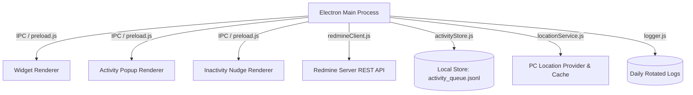
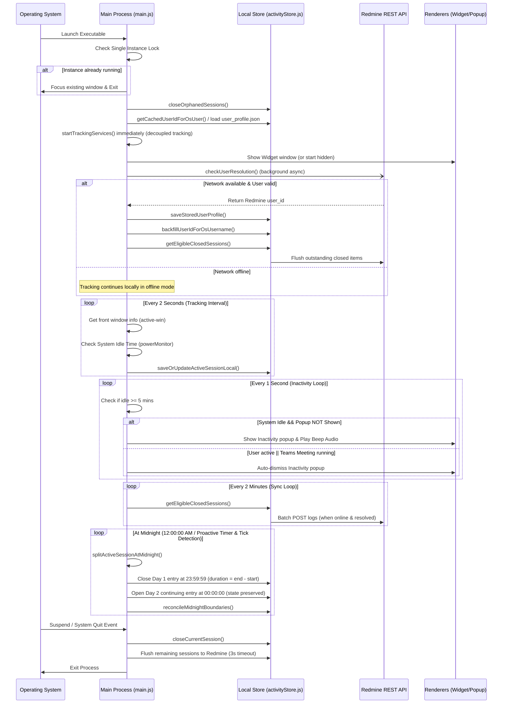

# WorkLens Desktop App | Technical Reference Manual (BRAIN.md)

This document is the single source of truth for the WorkLens Desktop Timelog & Activity Tracking application. It provides a complete conceptual, architectural, and detail-level breakdown of the project to enable any developer or AI assistant to be productive in under 2 minutes.

---

## 1. Project Overview

### Project Name
*   **WorkLens** (formerly *Daily Timelog*)

### Purpose & Problem Solved
WorkLens is a lightweight, system-level desktop productivity widget designed to track active and inactive working time. It automates employee timesheet logging by integrating with a Redmine-based backend, consolidating active window sessions locally, managing system sleep/resume/lock scenarios, and batch-uploading activity logs.
It solves:
1.  **Manual Timesheet Fatigue:** Eliminates the need for employees to track daily work logs manually.
2.  **API Server Overload:** Minimizes network requests on the backend by batching sync intervals (every 2 minutes) and consolidating similar sessions offline rather than sending telemetry every few seconds.
3.  **Inactivity Triggers:** Reminds users to stay focused when inactive via a nudge popup containing motivational quotes.

### Target Users
*   Employees tracking daily effort.
*   Redmine Administrators & Project Managers reviewing activity logs.

### Application Architecture
WorkLens is built on Electron's multi-process architecture. It consists of:
*   **Main Process:** Controls system-level events, active window tracking, idle state monitoring, power hooks (sleep/resume/lock/unlock), automated updates, and a local offline JSONL database.
*   **Renderer Processes:**
    1.  *Main Widget:* A minimalist, frameless desktop status window (185px × 60px) pinned to the bottom-right corner.
    2.  *Activity Detail Popup:* A glassmorphism/Fluent UI container presenting grouped active logs.
    3.  *Inactivity Nudge Card:* A transparent prompt playing audio alerts and displaying motivational quotes when idle time is exceeded.



---

## 2. Tech Stack

| Technology Layer | Solution | Version / Details |
| :--- | :--- | :--- |
| **Core Framework** | Electron | `^42.4.1` (Chromium + Node.js) |
| **Runtime Environment** | Node.js | Native inside Electron package |
| **Active Window Tracking** | `active-win` | `^8.2.1` (polls front window executable names/titles) |
| **Global Input Hook** | `uiohook-napi` | `^1.5.5` (global keyboard and mouse event listener) |
| **Local Cache Store** | JSON Lines File (JSONL) | `activity_queue.jsonl` managed in `%APPDATA%/WorkLens` |
| **API Client** | Native `fetch` wrapper | Standard JS fetch in Node.js (with custom header auth) |
| **Logging Utility** | `electron-log` | `^5.4.4` (7-day rotation, max 10MB per file) |
| **Auto Updates** | `electron-updater` | `^6.8.9` (releases synced via GitHub Provider) |
| **Configuration** | `dotenv` | `^16.4.5` (handles `.env` parsing) |
| **User Interface** | HTML5, CSS3, Vanilla JS | Fluent design elements, system beep audio via Web Audio API |
| **Build/Packaging System** | `electron-builder` | `^26.15.3` (NSIS target for Windows installer production) |

---

## 3. Folder Structure

The repository is structured to separate system-level logic from presentation assets.

```
WorkLens/
├── .agents/                    # Workspace agent customizations
├── assets/                     # Application assets
│   └── icon.png                # Main application icon (128x128px png)
├── dist/                       # Output folder for production builders (ignored)
├── node_modules/               # Dependencies (ignored)
├── renderer/                   # Front-end renderer window files
│   ├── activity-popup.css      # Style details for the glassmorphism activity details popup
│   ├── activity-popup.html     # HTML structure of the activity details popup
│   ├── activity-popup.js       # Reconciler and UI handler for the activity details popup
│   ├── index.html              # Main widget HTML layout
│   ├── renderer.js             # Main widget interface controller (triggers UI sync and event listeners)
│   └── style.css               # Main widget layout styling
├── anti-afk/                   # Modular Behavior Analysis Engine
│   ├── config.js               # Thresholds, weights, and decision levels
│   ├── eventQueue.js           # Rolling in-memory event buffer
│   ├── eventCollector.js       # Event collection and formatting
│   ├── keyboardFeatures.js     # Keyboard metrics extraction
│   ├── mouseFeatures.js        # Mouse metrics (distance, speed, curvature, clicks)
│   ├── windowFeatures.js       # Window focus metrics (switches, stays, ping-pong)
│   ├── idleFeatures.js         # Idle status and wake-up patterns
│   ├── featureExtractor.js     # Primary feature extraction interface
│   ├── behaviorAnalyzer.js     # Indicators for suspicious behaviors
│   ├── mousePatternDetector.js # Specific mouse automation pattern detector (Patterns A-D)
│   ├── scoreEngine.js          # Confidence scoring and developer overrides
│   ├── decisionEngine.js       # Classification (Human, Watch, Suspicious, Likely Automation)
│   └── antiAfkDetector.js      # Primary orchestrator and API endpoints
├── watchdog/                   # Watchdog & Auto-Recovery Subsystem
│   ├── worklens-watchdog.ps1   # Primary Windows PowerShell background watchdog monitor
│   ├── worklens-watchdog.vbs   # Zero-console stealth launcher for Windows startup
│   └── watchdog.js             # Node.js supervisor engine for dev/cross-platform supervision
├── activityStore.js            # Offline database manager (handles JSONL operations, pruning, and atomic writes)
├── antiAfkDetector.js          # Backward compatibility wrapper for the anti-AFK engine
├── CHANGELOG.md                # Evolution log of the desktop app
├── inactivityPopup.html        # Nudge UI & Web Audio beep synthesized tone code
├── logger.js                   # log configurations (resolves and purges logs older than 7 days)
├── main.js                     # Main Electron process driver (lifecycle, window creation, active-win tracking)
├── package.json                # Project configurations, builder targets, dependencies list
├── preload.js                  # IPC context bridge exposing APIs securely to renderer windows
├── quotes.js                   # Local quotes storage array for inactivity nudges
├── redmineClient.js            # Native fetch wrapper for Redmine HTTP REST requests
├── redmineTimeIntegration.js   # Service for Redmine GET time_entries API aggregation, yellow category classification, and view building
├── storageHealth.js            # Local persistence supervisor (ENOSPC detection, failure threshold, cooldown, notifications)
├── teamsActivityTracker.js     # Microsoft Teams intelligent call/meeting state machine and device sensor engine
├── run_all_tests.js            # Master automated test runner for all verification suites
├── test_redmine_yellow_integration_suite.js # Comprehensive test suite for Redmine time integration & yellow progress bar segments
├── test_mouse_pattern_suite.js # Comprehensive test suite for Python mouse automation pattern detection
├── test_teams_tracking_suite.js # Comprehensive test suite for Teams call/meeting state transitions and edge cases
├── test_storage_health_suite.js # Local storage health, ENOSPC resilience, and memory buffering suite
├── test_location_suite.js      # PC Location data acquisition, caching, and offline payload suite
├── test_offline_suite.js       # Offline startup, user profile caching, and identity reconciliation suite
├── test_session_times_suite.js # Session start/end boundaries, timestamp parser, and Present state suite
├── test_activity_periods_suite.js # Active time single-source 30-day API period aggregator suite
├── test_progressive_loading.js # Progressive loading and latency benchmark suite
├── test_hourly_activity_suite.js # Comprehensive test suite for hour-wise activity layout, interval calculation & expandable dropdowns
├── test_app_hours_toggle_suite.js # Comprehensive test suite for App-Wise and Hours-Wise view toggle, aggregation, and tab sync
├── test_midnight_session_split_suite.js # Comprehensive test suite for midnight session split, calendar boundaries & zero cross-day records
├── .env                        # Active environment configurations (not committed)
└── .env.example                # Example configuration template for environment setup
```

### Placement Guidelines
*   **Do Place in `renderer/`:** CSS files, scripts, and views that represent UI elements which run within a sandbox environment.
*   **Do Place in Root:** System-level logic modules, configuration structures, IPC interfaces, utility services, and state store files.
*   **Do NOT Place in `renderer/`:** Node modules imports, API clients directly making network requests, or direct filesystem access calls.

---

## 4. Entry Points

WorkLens has structured boundaries where processes start execution:

### 1. Main Process: [main.js](file:///c:/Users/karthikeya.kondavath/Desktop/Daily-Timelog-Main/WorkLens/main.js)
This is the application startup handler. Execution flows as follows:
*   Initializes the environment using `dotenv`.
*   Appends arguments like `--autoplay-policy=no-user-gesture-required` to enable automatic browser beep triggers.
*   Acquires the single-instance lock via `app.requestSingleInstanceLock()`.
*   Ensures the independent Watchdog supervisor is running and registered in Windows Startup.
*   Detects `--recovered` argument to display the recovery notification if automatically restarted.
*   Sets up system tray hooks and registers background loops:
    *   **Inactivity Check Interval (1 sec):** Closed-loop verification of user idle status.
    *   **Activity Tracking Tick (2 sec):** Queries active window titles and appends/consolidates them with clock skew / time jump protection.
    *   **Flush Sync Worker (2 min):** Flushes local cache records to the Redmine API with duration and date sanity filtering.
*   Executes update validations and binds power monitor and system lifecycle state listeners (suspend, resume, shutdown, session-end, lock, unlock).

### 2. Watchdog Supervisor: [watchdog/worklens-watchdog.ps1](file:///c:/Users/karthikeya.kondavath/Desktop/Daily-Timelog-Main/WorkLens/watchdog/worklens-watchdog.ps1) & [watchdog/worklens-watchdog.vbs](file:///c:/Users/karthikeya.kondavath/Desktop/Daily-Timelog-Main/WorkLens/watchdog/worklens-watchdog.vbs)
Independent background process monitoring WorkLens health:
*   Runs separately from `WorkLens.exe` (immune to Task Manager "End Task" on WorkLens).
*   Polls process health every 3 seconds.
*   Enforces 5-second grace period before recovery restart.
*   Implements restart-loop protection (maximum 3 restarts within a sliding 5-minute window).
*   Reads `%APPDATA%/WorkLens/watchdog-state.json` to avoid restarting during intentional system shutdowns, logoffs, or auto-updates.

### 3. IPC Context Bridge: [preload.js](file:///c:/Users/karthikeya.kondavath/Desktop/Daily-Timelog-Main/WorkLens/preload.js)
The bridge scripts run before renderer files load. It exposes a restricted `window.api` namespace containing method call mappings. It acts as a security barrier preventing the UI from executing arbitrary Node.js scripts.

### 4. Renderer Scripts
*   **[renderer/renderer.js](file:///c:/Users/karthikeya.kondavath/Desktop/Daily-Timelog-Main/WorkLens/renderer/renderer.js):** Coordinates values displayed by `renderer/index.html`. Handles clicks on the "Active Time" card to trigger details popups.
*   **[renderer/activity-popup.js](file:///c:/Users/karthikeya.kondavath/Desktop/Daily-Timelog-Main/WorkLens/renderer/activity-popup.js):** Runs inside the glassmorphism details window. Polls logging details from the main process and binds CSS layouts.

### 5. PC Location Provider & Cache: [locationService.js](file:///c:/Users/karthikeya.kondavath/Desktop/Daily-Timelog-Main/WorkLens/locationService.js)
Dedicated Windows-compatible PC location acquisition and reverse geocoding service:
*   Runtime PC location resolution via Windows Native Location (`System.Device.Location.GeoCoordinateWatcher`) with automatic network IP geolocation fallback (`ip-api.com` / `freeipapi.com`).
*   Reverse geocoding via OpenStreetMap Nominatim and BigDataCloud to produce human-readable addresses (`current_address`).
*   Periodic caching strategy (configurable, default 20 minutes) preventing per-event location lookups.
*   Zero renderer exposure and privacy-compliant logging (only high-level status messages).

---

## 5. Application Flow

The lifecycle flow of the application from startup to shutdown is structured as follows:



---

## 6. Feature Documentation

### 1. Frameless Widget Panel
*   **Purpose:** Provide employees with a non-intrusive status interface showing their recorded and logged times.
*   **Files Involved:** 
    *   [renderer/index.html](file:///c:/Users/karthikeya.kondavath/Desktop/Daily-Timelog-Main/WorkLens/renderer/index.html)
    *   [renderer/style.css](file:///c:/Users/karthikeya.kondavath/Desktop/Daily-Timelog-Main/WorkLens/renderer/style.css)
    *   [renderer/renderer.js](file:///c:/Users/karthikeya.kondavath/Desktop/Daily-Timelog-Main/WorkLens/renderer/renderer.js)
*   **UI Metrics Displayed:** 
    *   *Time Logs (Redmine Summary):* Shows yesterday's (Y) and today's (T) logged times returned by Redmine.
    *   *Active Time (Local Tracked Time):* Shows local tracked active time yesterday (Y) and today (T).
    *   *Status Dot:* A pulsing indicator representing "Active (Online)" (Green), "Active (Offline)" (Blue), or "Inactive" (Orange) states.
    *   *Close Button:* A Fluent-style close button (`widget-close-btn`) next to the date display. Clicking it gracefully hides the main widget and detail popup to run in the background (restorable via the system tray).

### 2. Active Window Tracking
*   **Purpose:** Continuously poll the top-most window in the OS to track where the user's attention is focused.
*   **Files Involved:**
    *   [main.js](file:///c:/Users/karthikeya.kondavath/Desktop/Daily-Timelog-Main/WorkLens/main.js) (tracking tick, active-win binding)
*   **Key Logic Rules:**
    *   **Lock Screen Exclusion:** Active tracking is suspended, and the status is set to `Inactive` if `lockapp.exe` (Windows Lock Screen) is detected.
    *   **Teams Intelligent Tracking:** Evaluates Teams state via `teamsActivityTracker.js`. Differentiates Teams chat (subject to standard 5-minute inactivity rules) from active voice calls and video meetings (forced `Active` and suppresses inactivity popups). Uses hardware sensor registry (`CapabilityAccessManager` microphone and webcam signals) combined with window title patterns, avoiding brittle string matching.
    *   **Passive Transfer Detection:** Flags active transfers (WinSCP or downloads matching percentage progress keywords like `\b\d{1,3}%\s+(downloading|uploading|transferring)\b`) as `Inactive` since they are running in the background.
    *   **Title Normalization:** Normalizes volatile percentage titles (e.g., "82% transferring") to static titles (e.g., "Transferring in progress") to prevent polluting the database.

### 3. Session Consolidation & Local Queue
*   **Purpose:** Consolidate active intervals into single rows in the database (up to 1 hour max) to limit server synchronization load.
*   **Files Involved:**
    *   [activityStore.js](file:///c:/Users/karthikeya.kondavath/Desktop/Daily-Timelog-Main/WorkLens/activityStore.js)
*   **Consolidation Criteria:** If app name, window title, activity status, and target tracking day match the current record, update the existing session's end time and duration instead of creating a new row. If any parameter changes, the current session is closed and queued for synchronization.

### 4. Inactivity Nudge
*   **Purpose:** Prompt employees visually and audibly when the workstation registers no keyboard or mouse inputs for more than 5 minutes.
*   **Files Involved:**
    *   [main.js](file:///c:/Users/karthikeya.kondavath/Desktop/Daily-Timelog-Main/WorkLens/main.js)
    *   [quotes.js](file:///c:/Users/karthikeya.kondavath/Desktop/Daily-Timelog-Main/WorkLens/quotes.js)
    *   [inactivityPopup.html](file:///c:/Users/karthikeya.kondavath/Desktop/Daily-Timelog-Main/WorkLens/inactivityPopup.html)
*   **Behavior Details:** Plays a dual-tone beep at 800Hz for 120ms (repeated after a 250ms delay). Auto-closes when user activity is detected, or after a 15-second timeout if no interaction occurs.

### 5. Detailed Activity Log View (with Hour-Wise Breakdown, Date-Range Selector & Progressive Loading)
*   **Purpose:** Provide users with an interactive, categorized breakdown of their active time organized hour-by-hour (09:00 AM – 10:00 AM, etc.) with expandable application dropdowns for Today and Yesterday, multi-day historical summaries (Last 7 Days, Last 30 Days), and ultra-fast UI rendering via progressive background loading.
*   **Files Involved:** 
    *   [renderer/activity-popup.html](file:///c:/Users/karthikeya.kondavath/Desktop/Daily-Timelog-Main/WorkLens/renderer/activity-popup.html)
    *   [renderer/activity-popup.css](file:///c:/Users/karthikeya.kondavath/Desktop/Daily-Timelog-Main/WorkLens/renderer/activity-popup.css)
    *   [renderer/activity-popup.js](file:///c:/Users/karthikeya.kondavath/Desktop/Daily-Timelog-Main/WorkLens/renderer/activity-popup.js)
    *   [preload.js](file:///c:/Users/karthikeya.kondavath/Desktop/Daily-Timelog-Main/WorkLens/preload.js) (`onHistoricalDataReady` bridge)
    *   [main.js](file:///c:/Users/karthikeya.kondavath/Desktop/Daily-Timelog-Main/WorkLens/main.js) (`loadHistoricalDataInBackground`, `processHistorical30DaysData`)
*   **Hour-Wise Activity Layout (Today & Yesterday):**
    *   *Time Slot Display:* Replaces the legacy app-wise list with continuous 12-hour hourly rows (e.g., `09:00 AM – 10:00 AM`, `10:00 AM – 11:00 AM`, `11:00 AM – 12:00 PM`, etc.) formatted with leading zeros and clean en-dash separators via `formatHourRange()`.
    *   *Dynamic PC Start & Present / End Boundaries:* The displayed hourly slots strictly start at the hour the PC/tracking began (`startTime`) and extend only up to `Present` (`now.getHours()` for Today) or the session end hour (`endTime` for Yesterday). Arbitrary default work hours (e.g., 9 AM or 6 PM) are never displayed if the user started later or finished earlier. Pre-start and post-end hours are cleanly excluded.
    *   *Hourly Row Layout:*
        1.  *Left:* Rotating chevron dropdown arrow (`.hourly-chevron-container`) and 12-hour slot range (`.hourly-time-range`, 148px tabular-nums).
        2.  *Center Column (`.hourly-center-col`):* A vertically stacked activity block containing:
            *   *Segmented Activity Bar (`.hourly-progress-container`):* Multi-colored horizontal bar where each application active during that hour occupies a segment (`.hourly-segment`) sized proportionally to `(appDuration / 3600) * 100%`, styled in distinct brand accent colors (`getAppColor()`: VS Code sky blue `#38bdf8`, Chrome warm orange `#fb923c`, Teams purple `#a855f7`, Edge mint green `#34d399`, etc.), with remaining width showing track background for idle time.
            *   *Mini Application Pills (`.hourly-app-pills`):* Positioned directly below the segmented bar, displays top application icons with their active duration (`.hourly-pill-item`, `.hourly-pill-icon`, `.hourly-pill-time`), e.g., `[VS Code icon] 40m  [Chrome icon] 15m  [Teams icon] 5m`. If more applications exist, aggregates remaining apps into `+N apps Xm` (`.hourly-pill-more`).
        3.  *Far Right:* Total active duration for that hour (`.hourly-duration`, 65px bold white tabular-nums). Empty hours display `0m` in muted slate.
    *   *Exact Interval Calculations (`computeHourlyActivity`):* Calculates each application and website/window's active time strictly within the hour interval `[slotStart, slotEnd)`. If a tracking chunk spans across an hour boundary (e.g., 09:45 to 10:15, 30m), active time is split proportionally across the boundary (15m in 09:00–10:00, 15m in 10:00–11:00) without double counting. Applications outside the hour are completely excluded.
    *   *Current Hour Capping:* For Today, the current hour (`isCurrentHour`) caps activity calculations at `now` (`Math.min(slotEnd, now.getTime())`), never including future time. Future hours after the current time are not generated.
    *   *Empty Hours:* Hours within the tracking period with no recorded activity display `0m`, an empty progress bar (0% fill), and an italicized message (`No activity recorded for this hour`) when expanded.
    *   *Authoritative Daily Total:* Daily Total Active Time is computed directly from active session logs without duplicate addition.
*   **Expandable Hour Details (Website / Window Table):**
    *   *Interaction:* Clicking anywhere on an hourly row or its chevron toggles the row's dropdown.
    *   *Independent Expansion:* Each hour expands and collapses independently (`expandedHours` Set); opening one hour does not collapse other expanded hours.
    *   *Website / Window Activity Table (`renderHourlyWindows`):* Inside each expanded hour (`.hourly-details-content`), renders a self-contained table card (`.hourly-table-card`):
        1.  *Headers (`.hourly-table-header`):* Two column headings: `WINDOW / WEBSITE` (left) and `ACTIVE TIME` (right).
        2.  *Rows (`.hourly-window-row`):*
            *   *Icon & Title (`.window-title-col`):* High-fidelity vector SVG icon (`getWindowIconSvg()` supporting Google Docs, YouTube, Notion, Gmail, Stack Overflow, GitHub, Teams, VS Code, Chrome, etc.) and clean window/website title (`formatWindowOrWebsiteTitle()`). For browsers, strips browser suffixes (`- Google Chrome`, `- Microsoft Edge`) and formats recognized web services (e.g., `docs.google.com – Project Plan`, `youtube.com`, `notion.so`, `mail.google.com`, `stackoverflow.com`). For desktop apps, preserves recorded window title without inventing URLs.
            *   *Progress Bar (`.window-progress-container`, `.window-progress-fill`):* Horizontal light-blue progress bar (`#38bdf8`) scaled relative to the maximum active window in that hour.
            *   *Duration (`.window-duration`):* Exact active time aligned to the right.
        3.  *Strict Exclusion:* Eliminates separate side panels, horizontal app selectors, large app headers, minute timelines, and launch buttons.
    *   *Smooth Animations:* 250ms CSS Grid accordion transition (`grid-template-rows: 0fr -> 1fr`) on `.hourly-details-wrapper` and 90-degree chevron rotation.
*   **Dynamic Footer (`#footer-label`, `#total-time`):**
    *   *Left:* Clock icon and dynamic period label (`#footer-label`) updated automatically across tab selections: `Total Active Time (Today)`, `Total Active Time (Yesterday)`, `Total Active Time (Last 7 Days)`, and `Total Active Time (Last 30 Days)`.
    *   *Right:* Highlighted bold duration in vibrant light blue (`#38bdf8`, 18px font-size, 700 font-weight) matching widget active cards.
*   **Progressive Loading & Fast Response Architecture:**
    *   **Today First Priority (< 20ms):** When the user opens the Active Time popup, Today data is fetched immediately from local queue storage (`getAllTodayLogs()`) and rendered instantly without waiting for the 30-day API call or network roundtrip.
    *   **Background Historical Loader:** The 30-day API (`/user_system_activity_logs/today.json?user_id=<id>`) is fired asynchronously in the background (`loadHistoricalDataInBackground()`) with an extended 90-second timeout to safely receive large datasets (14,000+ entries) without blocking the popup thread or renderer.
    *   **Single-Pass Precomputation (~8ms):** When the 14,000+ API entries arrive, `processHistorical30DaysData()` executes a single $O(N)$ pass that simultaneously categorizes Today, Yesterday, Last 7 Days, and Last 30 Days into `precomputedHistoricalCache` (60s TTL).
    *   **Instant Tab Switching (0ms):** The renderer stores rendered data in `clientViewCache`. Once historical data is ready, switching between Today, Yesterday, Last 7 Days, and Last 30 Days is instantaneous without any redundant API calls or recalculations. Scroll positions are automatically reset to top (`scrollTop = 0`) to show newest dates first.
    *   **Localized Loading State:** If the user clicks Yesterday, Last 7 Days, or Last 30 Days before background loading finishes, a localized non-blocking spinner (`<p id="loading-text">Loading historical data...</p>`) is shown only inside the list container while the popup header, tabs, and Today view remain fully interactive.
    *   **Event Signal & Cache Refresh (`historical-data-ready`):** When background processing finishes, the main process notifies the renderer. The renderer clears stale client historical caches and re-renders the active historical tab immediately with server-verified data.
*   **Session Start & End Time Boundaries:**
    *   **Today Tab:** Subtitle displays the earliest tracking start time for today and dynamically shows `Present` while WorkLens is actively tracking (`trackingInterval !== null`), e.g., `07 Oct 2026     09:32 AM → Present`. If tracking is inactive or stopped, it displays the latest valid session end time.
    *   **Yesterday Tab:** Subtitle displays the actual isolated tracking period between the earliest valid session start time and latest valid session end time for yesterday, e.g., `06 Oct 2026     09:41 AM → 06:52 PM`.
    *   **Last 7 Days & Last 30 Days Views:** Every calendar date row integrates the session timeline directly into the progress bar container. The Start Time (`09:30 AM`) is positioned on the left boundary, the active-time progress bar expands smoothly in the middle, and the End Time (`06:16 PM` or `Present` for today) is positioned on the right boundary, with the total Active Time duration on the far right.
    *   **Multiple Session Aggregation:** If a day contains multiple discontinuous sessions (e.g., 09:30–12:30 and 13:30–18:15), the display resolves to earliest start (`09:30 AM`) and latest end (`06:15 PM`).
    *   **App Restart Preservation:** Timestamps are computed across all session records (both from local queue chunks and server logs); restarting WorkLens does not reset the day's earliest start time.
    *   **Empty State:** Dates with no recorded activity display `-- → --` (or `--` on both boundaries) with zero progress bar width and `0m` duration without inventing timestamps.
*   **Weekend Visibility Toggle (`#weekend-toggle-container`, `#toggle-weekends`):**
    *   *Placement & UI:* Positioned at the top of the historical data section in `.date-controls-row`, immediately to the right of the date subtitle and above `#list-header`. Styled in Windows 11 Fluent dark glassmorphism with custom blue checkmark.
    *   *Label & Default:* Labeled **Show Weekends (Sat & Sun)** with a default unchecked state (`showWeekends = false`).
    *   *Tab Scope:* Displayed strictly on the **Last 7 Days** and **Last 30 Days** tabs. Hidden (`.hidden` / `display: none !important;`) on the **Today** and **Yesterday** tabs, preserving the original application breakdown layout.
    *   *Filtering Logic:* When unchecked, filters visible date rows and progress bars to show only Monday through Friday (`!isWeekend(dateStr)`). Saturdays (`dayOfWeek === 6`) and Sundays (`dayOfWeek === 0`) are excluded from chart categories, date labels, and rows. When checked, weekend entries appear with actual recorded time or zero-activity markers.
    *   *Date Evaluation:* Uses local calendar date components (`year`, `month - 1`, `day`) instantiated at local noon (`12:00:00`) to guarantee reliable weekday classification across month boundaries, leap years (e.g. Feb 29), and year transitions without timezone distortion.
    *   *Shared State & Zero-Overhead:* State is unified across historical tabs (`Last 7 Days` &harr; `Last 30 Days`). Toggling triggers instantaneous client-side re-rendering from `clientViewCache` with 0ms delay and zero additional API/IPC calls.
    *   *Data Immutability:* Underlying raw datasets (`rawData.days`) and total recorded period hours (`totalTimeEl`) are preserved and never mutated or deleted.
*   **Dynamic Daily Active Time Progress Bar Colors (`getDailyActiveTimeColor`):**
    *   *Threshold Rules:*
        *   **RED (`.color-red`, `.progress-red`):** Active time less than 7 hours (< 420 minutes / < 25,200 seconds). Evaluates zero-activity dates to red with 0% fill.
        *   **BLUE (`.color-blue`, `.progress-blue`):** Exactly 7 hours (420m / 25,200s) or exactly 7 hours 30 minutes (450m / 27,000s).
        *   **YELLOW (`.color-yellow`, `.progress-yellow`):** Greater than 7 hours but less than 7 hours 30 minutes (> 420 minutes && < 450 minutes / > 25,200s && < 27,000s). Renders with warm yellow gradient (`linear-gradient(90deg, #f59e0b, #fbbf24)`). Overrides the existing Blue color rule strictly for this duration range based on actual duration in minutes (e.g. 7h 01m, 7h 15m, 7h 29m).
        *   **GREEN (`.color-green`, `.progress-green`):** Active time strictly greater than 7 hours 30 minutes (> 450 minutes / > 27,000 seconds).
    *   *Scope & Consistency:* Applied across all daily rows in both Last 7 Days and Last 30 Days views strictly for System Activity (Track 1). Redmine Time Sheet progress bar (Track 2) colors remain completely untouched. Weekend rows, when toggled visible, adhere to the exact same color rules.
    *   *Preservation:* Preserves existing horizontal progress bar dimensions, rounded corners (2px), track styling, and width animation (350ms cubic-bezier). Total active time summary, date labels, start/end boundaries, database records, and tracking logic remain unmodified.
*   **Compact Title Truncation & Hover Tooltip (`.app-name`, `.activity-title`):**
    *   *Truncation Mechanics:* Long application names, website titles, and browser window titles are automatically truncated with an ellipsis (`text-overflow: ellipsis; white-space: nowrap; overflow: hidden; min-width: 0;`), preventing layout blowout, horizontal scrollbars, or table column displacement.
    *   *Responsive Sizing:* `.app-name` flexes dynamically (`flex: 0 1 200px; max-width: 240px; min-width: 0;`), allowing short titles to take minimal width while long titles expand up to 240px without crowding the progress bar (`min-width: 60px;`). Table header `.col-app` flexes proportionally (`flex: 1; min-width: 0;`).
    *   *Grid & Flex Containment:* Grid details wrappers (`.activities-details-wrapper`, `.activities-details-content`) and rows (`.activity-detail-row`) enforce `min-width: 0; overflow: hidden; width: 100%; box-sizing: border-box;`, ensuring child titles never push duration columns off-screen. Duration columns (`.app-duration`, `.activity-duration`, `.col-time`) remain rigidly aligned at fixed `80px`.
    *   *Full Title Tooltip & Keyboard Focus:* Complete untruncated titles are bound to the `title` attribute for native hover tooltips and `aria-label`. Elements include `tabindex="0"` and `:focus-visible` outline rings for full keyboard accessibility. Empty or whitespace titles cleanly fall back to `(Untitled Activity)`.
    *   *Data Immutability:* Truncation is purely presentational; underlying activity logs, database records, and API structures remain completely unmodified.
*   **Redmine Time Integration, Working Hours & Progress Bar Segments (`redmineTimeIntegration.js` & `renderer/activity-popup.js`):**
    *   *Integration Pipeline:* Combines Redmine GET timesheet API (`/time_entries.json`) with WorkLens workstation active tracking logs (`/user_system_activity_logs/today.json` + local queue) across the **Last 7 Days** and **Last 30 Days** views. Both queries run concurrently in the background (`loadHistoricalDataInBackground`) using `Promise.allSettled`.
    *   *Untouched System Activity Visualization (Track 1):* The existing WorkLens active tracking progress bar remains completely unmodified in width, segments, calculations, data source (`regularDuration` = `activeSeconds`), status colors (Red < 7h, Blue 7h–7h 30m, Green > 7h 30m), and behavior. It is strictly never recolored to Neon Magenta (`#FF00E5`) and never merged into Redmine time.
    *   *Redmine Working Hours (Track 2) in Neon Green (`#00E676`):* General Redmine time entries (Development, Project Management, Bugfix, etc.) are classified under the **Working** category and rendered as a separate progress bar (`.history-track-yellow.history-track-redmine` & `.history-segment-working`) directly below the System Activity bar:
        *   **Neon Green Styling:** Rendered with `#00E676` background fill and subtle glow (`box-shadow: 0 0 4px rgba(0, 230, 118, 0.35)`).
        *   **Proportional Scaling against 9h 30m Scale:** Length is calculated proportionally to daily Redmine logged hours against the standard 9 hours 30 minutes reference scale (570 minutes = 34,200 seconds = 100%): `(redmineSeconds / 34200) * 100`, visually capped at 100%.
        *   **Separate Right-Aligned Duration:** The actual logged Redmine duration (e.g. `5h 30m`) displays in Neon Green (`#00E676`, `.history-duration-working`) beside Track 2 on the second duration line in `.history-duration-col.has-two-bars`.
    *   *Strict Category & Color Preservation (5 Official Categories):*
        1. **Big Late** — `#FF1744`
        2. **Early Out** — `#FFD600`
        3. **Leave** — `#8B5CF6`
        4. **Holiday** — `#FF4081`
        5. **Working (Redmine API logged hours)** — `#00E676` (general project/task entries: Development, Testing, Bugfix, Data Analysis, Project Management, and all Non-Productive ABM Function/Activity entries)
        *Note:* 'Non Productive - ABM Function, Activity' is no longer displayed as a separate category or distinct color segment; its hours are directly classified and merged into the **Working** category (`#00E676`).
    *   *Multi-Category & Single-Category Support:* If a date row contains multiple categories (e.g. 4h Working + 1h Leave), Track 2 renders side-by-side proportional segments with their respective category colors. **Working hours (Neon Green `#00E676`, including any Non-Productive hours) are strictly positioned FIRST at the start (left) of the progress bar, and all extra/special hours (Leave, Holiday, Big Late, Early Out) appear at the END (right).** Single-category dates render a unified bar with that category's color.
    *   *Always-Visible Redmine Time Sheet Bar & Zero Hours Handling:* The Redmine Time Sheet progress bar (Track 2) is **always visible** across every applicable date row in both Last 7 Days and Last 30 Days views. When a date row has 0 Redmine logged hours, Track 2 renders an empty, zero-width progress bar (`width: 0%`) within its track container, and the right duration column displays `0h`. Both tracks (`.history-track-regular` and `.history-track-yellow.history-track-redmine`) and the two-row duration column (`.history-duration-col.has-two-bars`) are consistently present across all days, preserving rigid vertical alignment and identical row height.
    *   *Two-Way Tab Switch & Background Refresh:* Switching between **Last 7 Days** and **Last 30 Days** renders the corresponding period's Redmine hours from `precomputedHistoricalCache`. When background fetching completes, `main.js` emits `historical-data-ready`, causing `renderer/activity-popup.js` to invalidate `clientViewCache` and re-render the active historical period with synchronized Redmine data.
    *   *Enhanced History Legend:* Compact legend (`#history-legend`) displays two organized groups:
        *   *System Activity:* `● Red: <7h  ● Blue: 7h–7h 30m  ● Green: >7h 30m`
        *   *Redmine Hours:* `● Working (Redmine Logged Hours)  ● Big Late  ● Early Out  ● Leave  ● Holiday`
    *   *Compact Modal Proportions & Sizing:* Refined window dimensions of **690px width × 510px height** (configured in `createActivityWindow()` and `positionActivityWindow()` in `main.js`), with compact padding (`12px 16px` in `#popup-container`) and tight vertical spacing (`margin: 6px 10px 18px 10px`), allowing exactly 5 date rows to fit simultaneously in view without scrolling on Last 7 Days view.
    *   *Deduplication & Timezone Safety:* Deduplicates entries by stable `entry.id` to prevent double-counting across repeated fetches or paginated batches. Parses `spent_on` supporting both `DD-MM-YYYY` and `YYYY-MM-DD` without timezone or DST shifts. Safe rebuild from authoritative sources ensures cached totals are recalculated correctly without blind subtraction.
*   **Icon Caching:** Resolves executable file icons on the main thread using standard shell queries (`Get-Process`) and converts them to base64 images to prevent CPU overhead in the rendering process.

### 6. Anti-AFK & Enterprise Behavior Analysis Engine
*   **Purpose:** Exclude fake or automated activity from active time logs by continuously collecting user interaction events and extracting features to detect key-weights, mouse jigglers, and window focus loops.
*   **Files Involved:**
    *   [anti-afk/antiAfkDetector.js](file:///c:/Users/karthikeya.kondavath/Desktop/Daily-Timelog-Main/WorkLens/anti-afk/antiAfkDetector.js) (Pipeline Orchestration)
    *   [anti-afk/config.js](file:///c:/Users/karthikeya.kondavath/Desktop/Daily-Timelog-Main/WorkLens/anti-afk/config.js) (Weights & Threshold Constants)
    *   [anti-afk/eventQueue.js](file:///c:/Users/karthikeya.kondavath/Desktop/Daily-Timelog-Main/WorkLens/anti-afk/eventQueue.js) & [anti-afk/eventCollector.js](file:///c:/Users/karthikeya.kondavath/Desktop/Daily-Timelog-Main/WorkLens/anti-afk/eventCollector.js) (Rolling 300s Queue & Formatter, evaluated over a 60s window)
    *   [anti-afk/keyboardFeatures.js](file:///c:/Users/karthikeya.kondavath/Desktop/Daily-Timelog-Main/WorkLens/anti-afk/keyboardFeatures.js), [anti-afk/mouseFeatures.js](file:///c:/Users/karthikeya.kondavath/Desktop/Daily-Timelog-Main/WorkLens/anti-afk/mouseFeatures.js), [anti-afk/windowFeatures.js](file:///c:/Users/karthikeya.kondavath/Desktop/Daily-Timelog-Main/WorkLens/anti-afk/windowFeatures.js), [anti-afk/idleFeatures.js](file:///c:/Users/karthikeya.kondavath/Desktop/Daily-Timelog-Main/WorkLens/anti-afk/idleFeatures.js) (Statistical Feature Extractors)
    *   [anti-afk/behaviorAnalyzer.js](file:///c:/Users/karthikeya.kondavath/Desktop/Daily-Timelog-Main/WorkLens/anti-afk/behaviorAnalyzer.js) (Suspicious Behavior Identification)
    *   [anti-afk/scoreEngine.js](file:///c:/Users/karthikeya.kondavath/Desktop/Daily-Timelog-Main/WorkLens/anti-afk/scoreEngine.js) (Confidence scoring with developer false-positive bypasses)
    *   [anti-afk/decisionEngine.js](file:///c:/Users/karthikeya.kondavath/Desktop/Daily-Timelog-Main/WorkLens/anti-afk/decisionEngine.js) (Classifies score levels: Human, Watch, Suspicious, Likely Automation)
    *   [main.js](file:///c:/Users/karthikeya.kondavath/Desktop/Daily-Timelog-Main/WorkLens/main.js) (Fires hardware uIOhook key/mouse/scroll triggers and polls idle status)
*   **Behavioral Indicators & Weights:**
    *   `sameKeyRatio` (+25): Same key accounts for >= 95% of keyboard input in the rolling window.
    *   `lowEntropy` (+15): Shannon entropy < 1.0, indicating highly predictable or repeating key patterns.
    *   `constantInterval` (+20): Keystroke intervals have standard deviation < 15ms, showing regular artificial timing.
    *   `periodicClicks` (+15): Click intervals have standard deviation < 20ms.
    *   `pingPongSwitch` (+15): Switching back and forth (A-B-A-B) between windows. Bypassed for active developers if they show natural typing/clicks inside those windows.
    *   `noMouseMovement` (+10): Zero mouse movements, clicks, or scrolls in the rolling window.
    *   `longKeyHold` (+30): A key is held down continuously for >= 30 seconds. This also directly triggers the suspicious state.
    *   `windowSwitchWithoutInteraction` (+20): Window focus switches occur without corresponding key/mouse actions inside the windows.
    *   `softwareWindowSwitch` (+80): Window focus switches occur without any physical keyboard or mouse events (e.g. software API focus manipulation). Directly triggers suspicious state.

### 7. Sanity Guards & Time Skew Protection
*   **Purpose:** Prevent corrupted, inflated, or anomalous time entries caused by system sleep/wake, lid closes, CMOS battery glitches, or Windows Time Service clock jumps (e.g. Secure Time Seeding jumping to future years like 2050).
*   **Files Involved:**
    *   [main.js](file:///c:/Users/karthikeya.kondavath/Desktop/Daily-Timelog-Main/WorkLens/main.js)
    *   [activityStore.js](file:///c:/Users/karthikeya.kondavath/Desktop/Daily-Timelog-Main/WorkLens/activityStore.js)
*   **Implemented Guards:**
    *   **Time-Jump / Clock Skew Guard (`CLOCK_SKEW_THRESHOLD_MS = 15000`):** If the elapsed time between two 2-second tracking ticks exceeds 15 seconds (system suspended, laptop lid closed, or clock jumped forward) or is negative (< -5s, clock jumped backward), the active session is safely closed at the last valid tick timestamp rather than stretching over the sleep duration.
    *   **Max Session Duration Cap (`MAX_SESSION_DURATION = 43200`):** Caps any individual continuous session at a strict maximum of 12 hours (43,200 seconds). Prevents abnormal sessions (such as 88 hours or 210,384 hours) from ever being recorded.
    *   **Future Year & Corrupt Date Filter:** In `flushPendingClosedSessions()` and `getEligibleClosedSessions()`, any session whose start/end year is in the future (`> currentYear + 1`) or precedes `2024`, or whose duration exceeds 12 hours, is rejected from syncing to Redmine and purged.
    *   **System Shutdown & Session-End Handlers:** Binds `powerMonitor.on('shutdown')` and Electron `app.on('session-end')` to guarantee graceful session closure before Windows terminates the process on logoff or shutdown.
    *   `artificialIdleRecovery`: Resume/unlock followed immediately by window switching without input events.
*   **Loophole Prevention & Graceful Recovery:**
    *   **Window Switch Loophole Fixed**: Switching active windows no longer resets the suspicion status. Only genuine user interaction (different key pressed, natural curved mouse movement, scroll, or click) can reduce suspicion.
    *   **Recovery Mechanics**: If flagged as suspicious/automation, only genuine content keypresses (excludes control/modifier keys like Alt/Tab), mouse clicks, scrolls, or natural curved mouse movements (segment lengths > 3px, angle change between 0.05 and 3.0 rad, excluding sharp reversals) will clear the flag, flush the event queue, and reset suspicion.

### 8. Microsoft Teams Call & Meeting Tracking Engine
*   **Purpose:** Intelligently track Microsoft Teams activity by distinguishing voice calls, video meetings, and screen shares from routine chat and idle windows, ensuring employees are not falsely flagged as inactive during hands-free calls while still enforcing inactivity rules during normal chat.
*   **Files Involved:**
    *   [teamsActivityTracker.js](file:///c:/Users/karthikeya.kondavath/Desktop/Daily-Timelog-Main/WorkLens/teamsActivityTracker.js) (State machine, device sensor engine, title patterns)
    *   [main.js](file:///c:/Users/karthikeya.kondavath/Desktop/Daily-Timelog-Main/WorkLens/main.js) (Active tracking tick integration and inactivity popup check)
    *   [test_teams_tracking_suite.js](file:///c:/Users/karthikeya.kondavath/Desktop/Daily-Timelog-Main/WorkLens/test_teams_tracking_suite.js) (Dedicated 35-assertion test suite covering all 9 edge cases)
*   **State Machine States:**
    *   `TEAMS_CHAT_ACTIVE`: User is actively interacting with Teams chat/channels/navigation (keyboard/mouse active).
    *   `TEAMS_IDLE`: User has Teams chat/UI in the foreground but has produced no keyboard or mouse activity for 5 minutes (`>= 300s`). Flips session to `Inactive` and triggers the Inactivity Popup.
    *   `TEAMS_CALL_ACTIVE`: Active Teams voice call detected. Forces session status to `Active`, suppresses the 5-minute inactivity popup, and preserves full active session duration even with zero mouse/keyboard input.
    *   `TEAMS_MEETING_ACTIVE`: Active Teams video meeting or screen share detected. Forces session status to `Active`, suppresses the inactivity popup, and preserves full meeting duration.
    *   `TEAMS_CALL_OR_MEETING_ENDED`: Transitional state triggered when a call or meeting concludes. Immediately transitions to `TEAMS_CHAT_ACTIVE` and initiates a fresh 5-minute inactivity countdown from the exact conclusion time.
*   **Reliable Local Detection Signals (Beyond Window Title):**
    *   **Windows CapabilityAccessManager Registry Sensors:** Queries `HKCU\Software\Microsoft\Windows\CurrentVersion\CapabilityAccessManager\ConsentStore\microphone` and `...\webcam` to detect real-time audio capture and video streaming. If `LastUsedTimeStop == 0` or `LastUsedTimeStart > LastUsedTimeStop`, Teams is actively holding the audio or video device.
    *   **Meeting Window Title Hierarchy:** Identifies companion and overlay titles (e.g., `Meeting compact view | ...`, `Sharing control bar | ...`, `\bmeeting\b`, `\bconference\b`, `\bpresenting\b`, `\bscreen sharing\b`).
    *   **Process Architecture Context:** Accommodates modern Teams MSIX/WebView2 architecture (`ms-teams.exe` with `SlimCore` native media engine) and classic Teams (`teams.exe`).
*   **Transition & Grace Period Handling:**
    *   *Call Starts while Idle:* Immediately flips status from `Inactive` to `Active`, closes any active inactivity popup, and suppresses further popups.
    *   *Call Ends:* Does NOT immediately mark the user idle even if OS idle time exceeded 300s during the call. Restarts the 5-minute inactivity countdown from call conclusion (`callEndedAt`). Fresh keyboard/mouse input clears the baseline and restores standard OS idle tracking.
    *   *Background/Minimized Meeting:* When a meeting is active in the background and the system is otherwise idle (e.g., listening to a presentation on desktop), WorkLens maintains the session as `Active` under `Microsoft Teams` and suppresses the idle popup.
    *   *App Switching:* Switching away from Teams during an active call to work in Chrome or IDE immediately closes the Teams session cleanly with accurate duration and tracks the active work app normally.

### 9. Automatic Midnight Session Splitting & Local Calendar Day Boundary Guarantee
*   **Purpose:** Enforce strict 24-hour local calendar day boundaries for all activity records so that every entry belongs strictly to one day, starting at 12:00:00 AM (`00:00:00`) and ending at 11:59:59 PM (`23:59:59`). No activity entry is ever permitted to cross midnight into another date.
*   **Files Involved:**
    *   [activityStore.js](file:///c:/Users/karthikeya.kondavath/Desktop/Daily-Timelog-Main/WorkLens/activityStore.js) (`splitSessionAtMidnightBoundaries()`, `reconcileMidnightBoundaries()`, `saveOrUpdateActiveSessionLocal()`, `closeOrphanedSessions()`)
    *   [main.js](file:///c:/Users/karthikeya.kondavath/Desktop/Daily-Timelog-Main/WorkLens/main.js) (`splitActiveSessionAtMidnight()`, `scheduleMidnightBoundaryCheck()`, `startOrContinueCurrentSession()`, `closeCurrentSession()`, `trackTick()`)
    *   [test_midnight_session_split_suite.js](file:///c:/Users/karthikeya.kondavath/Desktop/Daily-Timelog-Main/WorkLens/test_midnight_session_split_suite.js) (Dedicated 15-test suite covering all 15 edge cases)
*   **Core Mechanics & Invariants:**
    1.  **Exact Boundary Timestamps:**
        *   Previous day entry ends at: `YYYY-MM-DDT23:59:59` (11:59:59 PM).
        *   Next day entry starts at: `YYYY-MM-(DD+1)T00:00:00` (12:00:00 AM).
        *   Durations follow exact integer second formula `Math.floor((endDate - startDate) / 1000)`. E.g., a session from 11:50 PM to 12:10 AM is split into 599s on Day 1 (11:50:00 to 11:59:59) and 600s on Day 2 (00:00:00 to 00:10:00).
    2.  **State & Classification Preservation:**
        *   Continuation entries inherit exact active/inactive status, application name, window title, activity type (e.g. `Suspicious Automation`, `Code Editing`), reason, and geolocation metadata.
        *   Idle and inactive sessions remain strictly `inactive` across midnight (never converts idle time into active time).
    3.  **Proactive Midnight Rotation:**
        *   `scheduleMidnightBoundaryCheck()` schedules a precise `setTimeout` targeted at `nextMidnight` (00:00:00.000). On firing, it splits the live session, writes the closed entry to disk, opens the Day 2 continuation record, and re-arms for the subsequent midnight.
    4.  **Reactive & Multi-Day Boundary Reconciliation:**
        *   If the system slept or was suspended across midnight, or clock skew occurred, `startOrContinueCurrentSession()` and `trackTick()` compare `recordDayStr !== nowDayStr` and trigger `splitActiveSessionAtMidnight()`.
        *   Multi-day spans (e.g., system sleeping over a long weekend across 3 days) loop through intermediate calendar days, producing closed entries (`00:00:00` to `23:59:59`) for each calendar day.
    5.  **Crash Recovery & Startup Reconciliation:**
        *   On application launch, `closeOrphanedSessions()` runs `reconcileMidnightBoundaries()`, scanning all persisted JSONL chunks and splitting any unclosed or spanning records left from a previous run before closing them.
    6.  **Store-Level Defense-in-Depth:**
        *   `saveOrUpdateActiveSessionLocal()` checks `startDay !== endDay`. If any caller attempts to persist a cross-day record, the store automatically splits it via `splitSessionAtMidnightBoundaries()`, persists both single-day chunks, records daily start times for both dates, and returns the active segment.

---

## 7. API Documentation

All API communications are handled in [redmineClient.js](file:///c:/Users/karthikeya.kondavath/Desktop/Daily-Timelog-Main/WorkLens/redmineClient.js). Requests require the `REDMINE_API_KEY` token, which is passed in the query parameters (`?key=...`) and as the `X-Redmine-API-Key` header.

### 1. User Account Resolution
*   **URL:** `GET /users.json`
*   **Parameters:** `name=<os_username>&limit=100`
*   **Purpose:** Fetch the user object matching the logged-in OS username to retrieve the Redmine user ID.
*   **Response Shape:**
    ```json
    {
      "users": [
        { "id": 42, "login": "karthikeya.k" }
      ]
    }
    ```

### 2. Logged Effort Timesheet
*   **URL:** `GET /today_timesheet.json`
*   **Parameters:** `user_id=<os_username>`
*   **Purpose:** Fetch total working hours logged today and yesterday in Redmine.
*   **Response Shape:**
    ```json
    {
      "user": { "id": 42, "name": "Karthikeya Kondavathri" },
      "yesterday": { "date": "2026-07-26", "hours": "7.5" },
      "today": { "date": "2026-07-27", "hours": "2.0" }
    }
    ```

### 3. Tracked Activity Summary
*   **URL:** `GET /user_system_activity_logs/summary.json`
*   **Parameters:** `user_id=<os_username>`
*   **Purpose:** Retrieve total active duration hours recorded on the server for today and yesterday.
*   **Response Shape:**
    ```json
    {
      "user_id": 42,
      "yesterday": { "date": "2026-07-26", "duration_hours": "6.83" },
      "today": { "date": "2026-07-27", "duration_hours": "1.5" }
    }
    ```

### 4. 30-Day Activity Log History & Active Time Single Source
*   **URL:** `GET /user_system_activity_logs/today.json`
*   **Parameters:** `user_id=<user_id>`
*   **Purpose:** Retrieve the full, raw list of activity logs for the last 30 calendar days. WorkLens reuses this existing API as the **single source of truth** for all historical Active Time views (Today, Yesterday, Last 7 Days, and Last 30 Days) without creating or requesting separate endpoints.
*   **Actual Response Shape:**
    ```json
    {
      "user_id": 890,
      "from": "08-09-2026",
      "to": "07-10-2026",
      "days": 30,
      "total_duration_seconds": 643134,
      "total_duration_hours": "178.65",
      "entries": [
        {
          "id": 2987130,
          "user_id": 890,
          "app_name": "Google Chrome",
          "window_title": "Microsoft Teams (PWA)",
          "start_time": "08-09-2026 10:09:09",
          "end_time": "08-09-2026 10:09:12",
          "duration": 2,
          "status": "active",
          "activity_on": "08-09-2026",
          "version": null,
          "activity_type": null,
          "redmine_created_on": null,
          "local_created_on": null
        }
      ]
    }
    ```
*   **Caching & Aggregation Architecture:**
    *   **Progressive Loading & Background Precomputation (`loadHistoricalDataInBackground`, `processHistorical30DaysData`):** Today is loaded immediately from local queue storage (<20ms). The 30-day API call is performed asynchronously in the background with an adaptive 90-second timeout in [redmineClient.js](file:///c:/Users/karthikeya.kondavath/Desktop/Daily-Timelog-Main/WorkLens/redmineClient.js) to reliably download large payloads (14,000+ entries, ~10MB) without premature aborts. Large HTTP response bodies are truncated in console output to prevent Event Loop thread stalls. A single-pass $O(N)$ parser loops through all entries in ~8ms to simultaneously build Yesterday, Last 7 Days, and Last 30 Days view structures.
    *   **In-Memory 60s Cache (`precomputedHistoricalCache`):** Responses and precomputed view models are cached in memory for 60 seconds (`HISTORICAL_CACHE_TTL_MS = 60000`). Tab switching executes in 0ms without re-querying the API.
    *   **In-Flight Request Deduplication (`historicalFetchPromise`):** If a user clicks a historical tab before the background fetch completes, it awaits the existing in-flight promise rather than spawning duplicate HTTP requests.
    *   **Automatic Cache Invalidation (`invalidateActivity30DaysCache`):** Triggered immediately whenever `flushPendingClosedSessions()` successfully syncs newly closed sessions.
    *   **Date Normalization (`normalizeToLocalDateStr`):** Converts server date strings (`DD-MM-YYYY` in `activity_on` or `start_time`) into canonical local date format (`YYYY-MM-DD`) for reliable date comparison.
    *   **Period Filtering:**
        *   **Today:** Returns immediately from local activity queue (`getAllTodayLogs`). Merges server entries if available and caches app icons.
        *   **Yesterday:** Filters `entries` where `dStr === yesterdayStr` using the 30-day API response as the single source of truth (resolving exact 7.2h active duration and avoiding double-counting). Falls back to local logs only when offline.
        *   **Last 7 Days:** Precomputed from the single-pass date buckets. Produces exactly 7 calendar dates ending today ($T_0$ down to $T_{-6}$, newest first), defaults zero-activity dates to `0m`, and sums total active seconds.
        *   **Last 30 Days:** Precomputed from the single-pass date buckets. Produces exactly 30 calendar dates ending today ($T_0$ down to $T_{-29}$, newest first), defaults zero-activity dates to `0m`, and sums total active seconds.

### 5. Submit Session Log
*   **URL:** `POST /user_system_activity_logs.json`
*   **Body Payload:**
    ```json
    {
      "user_id": 42,
      "app_name": "Google Chrome",
      "window_title": "WorkLens - Pull Requests",
      "start_time": "2026-07-27T11:00:00",
      "end_time": "2026-07-27T11:05:00",
      "duration": 300,
      "activity_on": "2026-07-27",
      "status": "active",
      "version": "1.1.7",
      "activity_type": "browsing",
      "redmine_created_on": "2026-07-27T11:05:00",
      "local_created_on": "2026-07-27T11:00:00",
      "latitude": "18.5204",
      "longitude": "73.8567",
      "current_address": "Koregaon Park, Pune, Maharashtra 411001"
    }
    ```
*   **Location Contract:**
    *   `latitude`: Approximate decimal latitude string (e.g. `"18.5204"`) or `null` if location unavailable.
    *   `longitude`: Approximate decimal longitude string (e.g. `"73.8567"`) or `null` if location unavailable.
    *   `current_address`: Human-readable reverse-geocoded address or `null` if reverse geocoding fails.
*   **Sync Behavior:** Batched every 2 minutes. Failed logs are retried with an exponential backoff delay. Offline historical records preserve their originally captured location when synced later.

---

## 8. Database & Persistent Storage Documentation

WorkLens uses lightweight file-based stores in `%APPDATA%/WorkLens` (resolved dynamically via `app.getPath('userData')`):

1. **Activity Queue Store (`activity_queue.jsonl`):**
   * **Format:** JSON Lines (JSONL). Each line represents an active/inactive session block.
   * **Purpose:** Buffers local tracked activity offline and queues sessions for sync with Redmine.

2. **Persistent User Profile Cache (`user_profile.json`):**
   * **Format:** JSON object `{ "os_username": string, "redmine_user_id": number, "last_resolved_at": string }`.
   * **Purpose:** Decouples offline startup from Redmine API reachability by caching the resolved numeric user ID associated with the current Windows OS username. It is **never pruned** by activity retention.
   * **Shared-PC Protection:** Only matches if the active Windows OS username matches `os_username`.

3. **Persistent Daily Tracking State (`daily_tracking_state.json`):**
   * **Format:** Date-indexed JSON object `{ [dateStr]: { [osUsername]: { "earliestStartTime": string (ISO), "os_username": string, "user_id": number, "updated_at": string } } }`.
   * **Purpose:** Preserves each employee's earliest tracking session start time across workstation restarts, PC reboots, app crashes, and offline periods. Even if local queues are compacted or server synchronizations take time, Today's earliest start timestamp is restored immediately at T=0ms upon application launch.
   * **Date & Employee Isolation:** Keyed by local calendar date (`YYYY-MM-DD`) and employee OS username. Rolling calendar days (midnight rollovers) calculate independent start times automatically. Retains 35 days of daily state and automatically prunes older dates to keep the store compact.

### Activity Queue Schema Properties (`activity_queue.jsonl`)

| Field Name | Type | Description |
| :--- | :--- | :--- |
| `local_id` | String | Unique UUID generated on the client. |
| `user_id` | Integer / Null | The resolved Redmine User ID (null during initial offline tracking). |
| `os_username` | String / Null | Windows OS username of the employee who generated the session. |
| `app_name` | String | Tracked executable application name (e.g., `chrome.exe`). |
| `window_title` | String | Window header title at the time of tracking. |
| `start_time` | String (ISO) | ISO start timestamp formatted in local system time. |
| `end_time` | String (ISO) | ISO end timestamp formatted in local system time. |
| `duration` | Integer | Total elapsed active time in seconds. |
| `activity_on` | String | Calendar log target date (`YYYY-MM-DD`). |
| `status` | String | Status flags (`active` or `inactive`). |
| `closed` | Boolean | True if the session has ended and is ready to sync. |
| `synced` | Boolean | True if the record has been uploaded to the Redmine API. |
| `retry_count` | Integer | Number of failed upload attempts. |
| `last_error` | String / Null | Error message from the last failed sync attempt. |
| `created_at` | String (ISO) | Local record creation timestamp. |
| `updated_at` | String (ISO) | Local record modification timestamp. |
| `latitude` | String / Null | Client PC latitude captured at session creation. |
| `longitude` | String / Null | Client PC longitude captured at session creation. |
| `current_address` | String / Null | Human-readable reverse-geocoded physical address. |

### Identity Reconciliation & Backfilling
When the application starts offline without a prior cached user ID, records are saved locally with `user_id: null` and `os_username`. Once internet connectivity is restored and Redmine resolves the user ID, `backfillUserIdForOsUsername(osUsername, userId)` updates all pending un-synced chunks with the resolved numeric `user_id` before invoking `flushPendingClosedSessions()`.

### Data Pruning & Optimization
To support Last 7 Days and Last 30 Days historical views while keeping storage size bounded, the write routine in [activityStore.js](file:///c:/Users/karthikeya.kondavath/Desktop/Daily-Timelog-Main/WorkLens/activityStore.js) retains synced records for 35 days before pruning from the `activity_queue.jsonl` file. Unsynced records are never pruned. `user_profile.json` is stored independently and is exempt from pruning.

### In-Memory Chunk Caching & Automated Date Indexing (`activityStore.js`)
To deliver sub-millisecond query execution times across all dashboard periods (Today, Yesterday, Last 7 Days, Last 30 Days) without full-table scans or redundant disk reads:
1. **Stat-Validated In-Memory Queue Cache:** `readChunks()` caches parsed activity chunks in memory alongside the queue file's modification timestamp (`mtimeMs`) and size (`size`) via `fs.statSync`. Subsequent reads return the cached array instantly unless file attributes indicate on-disk changes or cache invalidation was triggered.
2. **Automated Date Index (`cachedDateIndex`):** During queue parsing and atomic writes, an in-memory `Map<dateStr, Array<chunk>>` indexes chunks by local calendar date (`YYYY-MM-DD`). Lookups via `getChunksForDate(dateStr)` operate in $O(1)$ time, eliminating linear searches through thousands of activity records.
3. **Fast Substring Date Normalization:** `normalizeToLocalDateStr(ts)` leverages a direct substring slice (`ts.substring(0, 10)`) for standard ISO dates, avoiding regular expression compilation overhead.
4. **Persistent State & Profile Cache:** `storedDailyState` and `storedUserProfile` are cached in memory with file stat checks, avoiding up to 30 repeated synchronous JSON file reads during multi-day timeline calculations.

### Storage Health Supervision & ENOSPC (Disk Full) Resilience
WorkLens employs a dedicated storage health supervisor in [storageHealth.js](file:///c:/Users/karthikeya.kondavath/Desktop/Daily-Timelog-Main/WorkLens/storageHealth.js) to monitor local filesystem persistence without treating network unavailability as an app failure.

1. **Network vs. Local Storage Failure Isolation:**
   * Expected offline operation (no internet, backend down, API timeouts) is **NOT** an application failure. Local tracking and queuing continue without triggering alerts.
   * Actual local failure occurs when WorkLens is actively running and collecting activities, but local persistence fails repeatedly due to full storage (e.g., C: drive at 100%), permission restrictions (`EACCES`/`EPERM`), or locked files (`EBUSY`).

2. **Atomic Write Protection Against ENOSPC Truncation:**
   * Traditional direct file writes truncate existing files to 0 bytes upon open before failing on write during ENOSPC, risking loss of offline un-synced records.
   * `writeChunks()` utilizes an atomic write pattern: writes to `activity_queue.jsonl.tmp` and renames to `activity_queue.jsonl`. If storage is full, the write fails safely without altering the existing queue file.

3. **In-Memory Buffer Preservation:**
   * Sessions generated during disk-full events are buffered in an in-memory map (`unpersistedChunks`).
   * When disk space is freed up, the next write flushes all in-memory buffered records to disk alongside existing records—guaranteeing zero data loss.

4. **Consecutive Failure Protection & Cooldown:**
   * **Failure Threshold:** Requires 3 consecutive persistence failures before transitioning state to `WORKLENS_NOT_WORKING`. Transient single-write glitches are logged but do not trigger notifications.
   * **Notification Cooldown:** Implements a 30-minute cooldown window to avoid notification spam while storage remains full.
   * **Employee-Friendly Notifications:** Technical errors (`ENOSPC`, `errno -4055`) are converted to clear guidance: *"WorkLens is not working properly because your system storage may be full. Please free up disk space."*
   * **Recovery Detection:** Upon the first successful local write following an alert, WorkLens transitions to `WORKLENS_RECOVERED` and issues a one-time resolution notification: *"WorkLens is working normally again."*

---

## 9. State Management

WorkLens manages application state across memory and local storage:

```
┌────────────────────────────────────────────────────────┐
│                      MEMORY STATE                      │
│                                                        │
│  currentRecord: Current active tracking session block   │
│  cachedUserId: Resolved numeric Redmine user ID        │
│  isUserResolved: Flag indicating user identity valid   │
│  isBackendReachable: Redmine server reachability state │
│  appIconCache: Base64 icons mapped by app name         │
│  cachedActiveTimeToday/Yesterday: Tracker cache        │
│  activitySummaryCache: 5s API responses cache          │
└──────────┬──────────────────────────────────▲──────────┘
           │ Writes                           │ Reads
           ▼                                  │
┌─────────────────────────────────────────────┴──────────┐
│                   PERSISTENT STORAGE                   │
│                                                        │
│  user_profile.json: Persistent mapping (os -> user_id) │
│  daily_tracking_state.json: Day start times per user   │
│  activity_queue.jsonl: Unsynced & recently synced logs │
│  logger.js (Logs folder): Local troubleshooting logs   │
└────────────────────────────────────────────────────────┘
```

*   **Temporary Memory Buffers:** Keeps current trackers and user sessions in memory for fast performance.
*   **Summary Caching:** Caches activity summaries for 5 seconds to prevent concurrent requests to the Redmine API when updating the widget.

---

## 10. PC Location Tracking & Caching Provider (`locationService.js`)

WorkLens captures runtime physical workstation location to verify work locations without blocking activity tracking or violating privacy:

### 1. Location Acquisition Flow
```
Windows PC Workstation
      │
      ├── 1. High-Accuracy Wi-Fi Triangulation (Chromium Background Geo Provider)
      │      (Scans nearby Wi-Fi BSSIDs for exact street-level accuracy, e.g. Linking Road, Bandra West)
      │
      ├── 2. Windows Native Location (System.Device.Location via PowerShell)
      │      (OS / hardware positioning)
      │
      └── 3. Network Geolocation Fallback (ip-api.com / freeipapi.com)
             (ISP gateway IP fallback)
      │
      ▼
Accurate Coordinates (latitude, longitude)
      │
      ├── 4. Reverse Geocoder (OpenStreetMap Nominatim / BigDataCloud)
      │
      ▼
Human-Readable Address (current_address & location)
      │
      ▼
Cached PC Location (15-30 min TTL, default 20 min)
      │
      ├── Attached to new active session records upon boundary creation
      ├── Preserved in offline queue (activity_queue.jsonl)
      └── Included in POST /user_system_activity_logs.json
```

### 2. Caching & Startup Warm-Up Strategy
*   **Persistent Disk Cache (`location_cache.json`):** Saves resolved location to `%APPDATA%/WorkLens/location_cache.json`. On cold launch, location is restored synchronously into memory at T=0ms.
*   **Startup Warm-Up:** `locationService.initLocationService()` is invoked before tracking starts, with up to a 2-second warm-up window (`waitForInitialLocation()`) ensuring initial sessions capture coordinates immediately.
*   **Dynamic Session Backfill:** If a session began before the initial location resolved, every subsequent tracking tick checks and backfills coordinates into `currentRecord` as soon as the provider resolves. Additionally, `closeCurrentSession()` and `syncChunkToApi()` apply the latest cached location if the chunk lacks coordinates.
*   **Dual Payload Compatibility:** Transmits both `current_address` and `location` alias fields in `POST /user_system_activity_logs.json` to ensure compatibility with backend schema contracts.
*   **Configurable Periodic Refresh:** Refreshes location on a timer (default: 20 minutes, configurable via `WORKLENS_LOCATION_REFRESH_MINUTES`).
*   **No Per-Tick Overhead:** Session tracking ticks (every 2 seconds) read synchronously from in-memory `cachedLocation`.
*   **In-Flight Request Deduplication:** Concurrent calls to `refreshLocation()` share a single in-flight resolution promise.

### 3. Offline-First Preservation (Historical Location Guarantee)
*   When the PC is offline or disconnected, activities are tagged with the location captured at the time the session began and persisted to `activity_queue.jsonl`.
*   If an employee travels from City A (e.g., Pune) to City B (e.g., Mumbai) before reconnecting, previously recorded offline sessions retain City A's coordinates and address. They are never overwritten by the current location during later synchronization.

### 4. Failure Resilience & Graceful Fallbacks
*   If network is unavailable, Windows location permissions are denied, or external geocoders time out, WorkLens sets `latitude: null`, `longitude: null`, and `current_address: null`.
*   If reverse geocoding fails while coordinates are valid, valid coordinates are preserved with `current_address: null`.
*   Activity tracking, active time calculation, idle detection, and offline queuing continue with zero interruption.

### 5. Security, Privacy & Logging Guidelines
*   **Strict Console Sanitization:** In accordance with privacy standards, raw coordinates are never printed to terminal or production log files.
*   **Standardized Status Logs:** Logs only high-level status messages:
    *   `[Location] Location update successful`
    *   `[Location] Location unavailable`
    *   `[Location] Reverse geocoding failed`
    *   `[Location] Location service initialized`
*   **No Front-End Exposure:** Location data remains exclusively in the Electron main process and persistence layer, never exposed over `preload.js` or renderer processes.

---

## 10. IPC & Event Flow

Preload bridges access paths by mapping handlers across processes:

| IPC Channel | Direction | Payload | Purpose |
| :--- | :--- | :--- | :--- |
| `get-username` | Invoked by UI | None | Returns `{ username: string, isOffline: boolean, isTrackingActive: boolean, error: string|null }` containing OS username, offline state, and explicit Redmine validation errors. |
| `get-employee-id` | Invoked by UI | None | Returns numeric Redmine ID. |
| `get-app-version` | Invoked by UI | None | Returns active semantic version string. |
| `get-redmine-efforts` | Invoked by UI | None | Returns today's and yesterday's logged times from Redmine. |
| `get-active-time-today` | Invoked by UI | None | Returns total local tracked seconds today (including offline & unsynced). |
| `get-active-time-yesterday` | Invoked by UI | None | Returns total local tracked seconds yesterday. |
| `get-current-status` | Invoked by UI | None | Returns active state (`Active`, `Offline`, or `Inactive`). |
| `get-storage-health` | Invoked by UI | None | Returns local storage health snapshot `{ activityCollectionWorking, localStorageWorking, offlineQueueWorking, lastSuccessfulLocalWrite, lastStorageError, storageFailure, consecutiveFailures, isUnhealthy, status }`. |
| `toggle-activity-popup` | Invoked by UI | None | Shows/hides the activity log details window. |
| `open-activity-popup` | Invoked by UI | None | Positions and displays the activity popup. |
| `close-activity-popup` | Invoked by UI | None | Closes/hides the activity popup. |
| `close-inactivity-popup`| Invoked by UI | None | Closes/destroys the inactivity nudge window. |
| `fetch-activity-logs` | Invoked by UI | `period` (`'today'` \| `'yesterday'` \| `'last7days'` \| `'last30days'`, default: `'today'`) | Returns active time logs or history summaries based on period. For Today/Yesterday: returns `{ period, date, logs, icons, startTime, endTime, isPresent, isTrackingActive, hasData }`. For Last 7 Days/Last 30 Days: returns `{ period, days: [{ dateStr, displayDate, shortDate, isToday, duration, startTime, endTime, isPresent, hasData }], totalSeconds, dateRange }`. |
| `fetch-activity-history`| Invoked by UI | `period` (`'last7days'` \| `'last30days'`) | Returns date-wise active duration breakdown and total seconds for the specified period. |
| `popup-ready` | Invoked by UI | None | Signals main process that the details window is ready. |
| `trigger-sync` | Invoked by UI | None | Explicitly triggers an offline-queue sync. |
| `hide-main-window` | Invoked by UI | None | Gracefully hides the main widget and detail popup, running tracking in the background. |
| `popup-status-changed` | Sent by Main | Status string (`opened`/`closed`) | Controls background polling loops. |
| `update-arrow-position` | Sent by Main | `arrowLeft` (int), `isBelow` (bool) | Updates pointer layout on details popup. |
| `request-close` | Sent by Main | None | Triggers close transitions inside UI windows. |
| `historical-data-ready` | Sent by Main | `{ isReady: boolean }` | Notifies activity popup renderer when background historical precomputation is complete. |
| `app-icons-updated` | Sent by Main | `icons` (`Record<string, string>`) | Asynchronously pushes newly scanned application icons to renderer without blocking `handleFetchActivity`. |

---

## 11. Background Jobs

WorkLens runs several key background processes:

### 1. Activity Monitoring Tick
*   **Interval:** Every 2 seconds.
*   **Logic:** Polls `active-win` and `powerMonitor.getSystemIdleTime()`. Updates the current in-memory record and persists updates to the local JSONL queue.

### 2. Inactivity Monitor Loop
*   **Interval:** Every 1 second.
*   **Logic:** Monitors system idle time. Shows the inactivity nudge window if idle time exceeds 5 minutes (`INACTIVITY_THRESHOLD_SECONDS = 300`).

### 3. Sync Flush Task
*   **Interval:** Every 2 minutes.
*   **Logic:** Uploads closed, unsynced sessions from the queue to Redmine.
*   **Retry Handling:** Implements exponential backoff (`2^(retry_count - 1)` minutes, up to a maximum of 60 minutes) for failed logs.

### 4. Auto Update Checker
*   **Interval:** On startup, and repeated every 4 hours.
*   **Logic:** Calls GitHub release endpoints to download and install updates.

### 5. Startup Cleanup Tasks
*   Closes orphaned sessions (where `closed: false` from a previous session).
*   Prunes log files older than 7 days from the logs folder.

### 6. User Resolution Retry Loop
*   **Interval:** Every 30 seconds.
*   **Logic:** Retries validating the local Windows username against the Redmine backend `/today_timesheet.json` API. If validation fails (due to backend username changes), all tracking services are stopped immediately. If validation succeeds again, cached user info is updated and all tracking/sync services are resumed automatically. Allows recovering user IDs from local queues during offline boot-up.

### 7. Watchdog Health Polling Loop
*   **Interval:** Every 3 seconds.
*   **Location:** [watchdog/worklens-watchdog.ps1](file:///c:/Users/karthikeya.kondavath/Desktop/Daily-Timelog-Main/WorkLens/watchdog/worklens-watchdog.ps1) (and [watchdog/watchdog.js](file:///c:/Users/karthikeya.kondavath/Desktop/Daily-Timelog-Main/WorkLens/watchdog/watchdog.js)).
*   **Logic:** Supervises WorkLens process availability independently of the Electron runtime:
    *   Detects unexpected termination (crashes, Task Manager "End Task").
    *   Checks `%APPDATA%/WorkLens/watchdog-state.json` to avoid false restarts during intentional shutdowns.
    *   Waits a 5-second grace period before relaunching.
    *   Enforces restart-loop protection (max 3 restarts within 5 minutes).
    *   Passes `--recovered` flag on restart to display recovery notifications.

---

## 12. Watchdog & Auto-Recovery Subsystem

### 1. Architectural Motivation
If an employee terminates WorkLens using Windows **Task Manager → End Task**, or if the Electron application encounters an unexpected native crash (e.g. GPU process crash or out-of-memory error), the WorkLens main process cannot recover itself. A completely separate, decoupled watchdog process is required.

### 2. Supervision Architecture

```
Windows Boot / Login
        │
        ▼
WorkLens Watchdog (Hidden PowerShell / VBS)
        │
        ├── Check WorkLens process
        │
        ├── WorkLens Running?
        │       │
        │       ├── YES ──► Sleep 3s ──► Check again
        │       │
        │       └── NO
        │            │
        │            ├── Intentional Shutdown flag set?
        │            │      ├── YES ──► Skip restart (honor user/OS shutdown)
        │            │      └── NO
        │            │           │
        │            ▼           ▼
        │       Wait 5-second grace period
        │            │
        │            ├── Check Restart Loop Limit (≤ 3 attempts in 5 mins)
        │            │      ├── EXCEEDED ──► Halt restarts & display alert dialog
        │            │      └── OK
        │            │           ▼
        │                   Start WorkLens with `--recovered`
        │                        │
        │                        ▼
        │                   Log recovery event & display user toast notification
```

### 3. Key Components
1. **[watchdog/worklens-watchdog.ps1](file:///c:/Users/karthikeya.kondavath/Desktop/Daily-Timelog-Main/WorkLens/watchdog/worklens-watchdog.ps1):**
   *   Core Windows PowerShell monitor running hidden in background.
   *   Consumes ~15–20 MB memory with ~0% CPU.
   *   Isolated from WorkLens process tree (Task Manager "End Task" on WorkLens leaves PowerShell running).
   *   Maintains single watchdog instance lock at `%APPDATA%/WorkLens/watchdog.lock`.
2. **[watchdog/worklens-watchdog.vbs](file:///c:/Users/karthikeya.kondavath/Desktop/Daily-Timelog-Main/WorkLens/watchdog/worklens-watchdog.vbs):**
   *   Stealth launcher using Windows Script Host (`wscript.exe`) to execute the PowerShell monitor with window style `0` (hidden), preventing command prompt flashes.
   *   Packaged outside `app.asar` into `<installDir>\resources\watchdog\worklens-watchdog.vbs` via `extraResources` because Windows Script Host is a native Windows binary that cannot access files inside Electron ASAR archives.
3. **[watchdog/watchdog.js](file:///c:/Users/karthikeya.kondavath/Desktop/Daily-Timelog-Main/WorkLens/watchdog/watchdog.js):**
   *   Node.js supervisor equivalent for developers and cross-platform verification (`npm run watchdog`).
4. **State File (`%APPDATA%/WorkLens/watchdog-state.json`):**
   *   Tracks `execPath`, `appPath`, `isPackaged`, `pid`, `intentionalShutdown`, `reason`, and `timestamp`.
   *   When WorkLens performs a clean application exit (`before-quit` or `autoUpdater.quitAndInstall()`), `intentionalShutdown` is set to `true`.
   *   System-level OS events (`powerMonitor.on('shutdown')` and `app.on('session-end')`) record `intentionalShutdown: false` (with `reason: 'shutdown'` or `reason: 'session-end'`), ensuring OS restarts and user logoffs do not block WorkLens from auto-starting on the subsequent Windows sign-in.
   *   When killed unexpectedly via Task Manager, no flag is written, allowing the watchdog to identify the termination as an abnormal event.

### 4. Restart-Loop Protection
*   The watchdog maintains an in-memory queue of restart timestamps.
*   Timestamps older than 300 seconds (5 minutes) are pruned.
*   If 3 restart attempts occur within 5 minutes, automatic restarts are suspended to prevent infinite crash loops.
*   A native Windows dialog is displayed: *"WorkLens could not be started after multiple attempts. Please contact support."*

### 5. Windows Auto-Start Integration
*   **Native Windows Startup Apps Entry (`WorkLens`):**
    *   WorkLens registers its native executable (`WorkLens.exe`) in `HKCU\Software\Microsoft\Windows\CurrentVersion\Run` and configures Electron's `app.setLoginItemSettings({ openAtLogin: true, openAsHidden: false, path: process.execPath, args: ['--startup'] })`.
    *   Ensures WorkLens is visible with native branding, application icon, and publisher (*"ABM Knowledgeware Ltd."*) in Windows Settings &rarr; Apps &rarr; Startup and Task Manager &rarr; Startup apps.
*   **Independent Watchdog Supervisor Entry (`WorkLensWatchdog`):**
    *   WorkLens registers `WorkLensWatchdog` in `HKCU\Software\Microsoft\Windows\CurrentVersion\Run`.
    *   Points dynamically to:
        *   **Development:** `wscript.exe "<projectRoot>\watchdog\worklens-watchdog.vbs"`
        *   **Production:** `wscript.exe "<installDir>\resources\watchdog\worklens-watchdog.vbs"` (resolved dynamically via `process.resourcesPath`).
    *   Never points into `app.asar`. Auto-corrects legacy or stale `app.asar` registry entries on startup or install/upgrade.
*   **Installer Unconditional Registration:**
    *   `build/installer.nsh` (`customInstall`) unconditionally registers both `WorkLens` and `WorkLensWatchdog` upon installation and update, ensuring startup is immediately active on fresh machines even before the first manual launch.
    *   Cleans legacy `electron.app.WorkLens` entries to avoid duplicate startup instances.
*   **Mode-Aware Launching:**
    *   On Windows login, the app launches with `--startup` to suppress unwarranted crash notifications.
    *   `--recovered` is exclusively reserved for mid-session crash and Task Manager termination recovery.

---

## 13. Configuration & Environment

Configuration parameters are loaded from the environment:

*   **`REDMINE_BASE_URL`:** The endpoint domain hosting the target timesheet interface.
*   **`REDMINE_API_KEY`:** Access token permissions associated with client write actions.
*   **`app.isPackaged` Resolution:** In development, config parameters are loaded from the project root directory. In production, they are loaded from `.env` in the packaged resources directory (`process.resourcesPath`).

### Hardcoded Configuration Constants

```javascript
const INACTIVITY_THRESHOLD_SECONDS = 300; // 5 mins idle limit
const IDLE_CHECK_INTERVAL_MS = 1000;       // 1s idle status verification
const POPUP_AUTO_CLOSE_MS = 15000;         // 15s nudge auto-close timeout
```

---

## 14. External Integrations

### Redmine Server
*   **Authentication:** API token auth via the `X-Redmine-API-Key` header and the `?key=` query parameter.
*   **Payload Types:** JSON payload formatting is used for all transactions.

### GitHub Releases
*   **Target Integration:** Automated updates using `electron-updater`.
*   **Repository Configuration:** Configured in `package.json`:
    ```json
    "publish": {
      "provider": "github",
      "owner": "karthikeyaabm",
      "repo": "worklens",
      "releaseType": "release"
    }
    ```

---

## 15. Build & Release Process

WorkLens uses `electron-builder` to package the application.

```bash
# 1. Run widget in development mode
npm start

# 2. Package installer files for Windows (.exe installer via NSIS)
npm run build

# 3. Publish builds to GitHub Releases (runs updater pipelines)
npm run release
```

### Packaging Details
*   **Application ID:** `com.worklens.desktop`
*   **Resources Packaging:** The `.env` configuration file and watchdog supervisor scripts (`watchdog/worklens-watchdog.vbs`, `watchdog/worklens-watchdog.ps1`, `watchdog/watchdog.js`) are packaged outside `app.asar` into `resources/` via `extraResources`. This ensures Windows Script Host (`wscript.exe`) and PowerShell execute real filesystem files outside the archive, preventing ASAR resolution failures.
*   **NSIS Installer / Uninstaller Configuration:**
    *   `oneClick`: `true` (seamless background installations and automated updates).
    *   `perMachine`: `false` (remains per-user at `%LOCALAPPDATA%\Programs\worklens`).
    *   `allowElevation`: `true`.
    *   `deleteAppDataOnUninstall`: `false` (strictly preserves `%APPDATA%\WorkLens` runtime data, queue, and logs).
    *   `include`: `build/installer.nsh`.
*   **Uninstaller Elevation Guard (`build/installer.nsh`):**
    *   Enforces Windows Administrator credentials via UAC (`UAC_RunElevated` macro) inside `customUnInit`.
    *   Standard non-admin employees are blocked from uninstalling through Windows Settings, Control Panel, or `Uninstall WorkLens.exe`.
    *   If elevation is cancelled or invalid credentials provided, uninstallation aborts immediately with zero file deletion.
    *   Includes Over-The-Shoulder (OTS) elevation handling: explicitly binds `$INSTDIR` to `$EXEDIR` and ensures clean shortcut and HKCU cleanup in employee session upon successful administrator elevation.
    *   Preserves 100% silent background auto-updates via `electron-updater` without requiring admin credentials on each release.

---

## 16. Coding Standards

*   **Separation of Concerns:** Keep OS API calls, window states, and process logic in the Main Process. Renderer files should focus on UI rendering and styles.
*   **Secure Preload Exposure:** Do not expose Node's `require` or native bindings to the renderer. Use the context bridge to define APIs.
*   **Robust Error Handling:** Wrap all API requests and window tracking calls in `try-catch` blocks to prevent crashes on network failures or application switches.
*   **User Path Safety:** Use `app.getPath('userData')` to resolve file paths. Do not use hardcoded root folders.
*   **Time Tracking Units:** Use seconds for logs in the database. Convert these to decimal hours (e.g., `1.5h`) when displaying them in the UI.

---

## 17. Known Issues & Limitations

1.  **Browser Title Overloads:** Tracking browser windows can create multiple short log entries when switching tabs rapidly. (Mitigated by the 2-minute sync interval and session consolidation rules).
2.  **OS Support:** Platform-specific window titles (such as the Windows lock screen `lockapp.exe`) must be configured manually for other operating systems.
3.  **Active Teams Override (Resolved):** Previously, Teams idle bypass relied solely on naive window title string matching. This is now fully resolved with `teamsActivityTracker.js` using Windows `CapabilityAccessManager` hardware sensors (microphone/webcam real-time access) coupled with an explicit state machine and 5-minute post-call grace period.

---

## 18. TODO Roadmap

*   [ ] **Ignore List UI:** Allow users to filter out specific processes (such as games or system apps) from being tracked.
*   [ ] **Category Mapping:** Automatically group application logs into categories like "Development", "Meetings", or "System Admin".
*   [ ] **Manual Log Correction:** Allow users to correct or manually adjust recorded time logs before they sync to Redmine.
*   [ ] **Cross-Platform Support:** Extend window tracking and system idle detection to macOS and Linux.

---

## 19. Important Business Logic

### Session Consolidation Algorithm
*   Calculates active intervals by comparing process parameters every 2 seconds.
*   If `appName`, `windowTitle`, `status`, and `day` match the current record, the active session is updated.
*   If the app changes, the system locks, or a new day begins, the current session is closed and written to the JSONL queue.

### Active/Inactive State Resolution

```
                  ┌──────────────────────────┐
                  │   Is Workstation Locked  │
                  │   (e.g., lockapp.exe)?   │
                  └────────────┬─────────────┘
                               │
                      Yes ┌────┴────┐ No
            ┌─────────────┴─┐     ┌─┴────────────────────────┐
            │ Flag INACTIVE │     │ Is System Idle >= 5m     │
            └───────────────┘     │ (Keyboard/Mouse Inactive)│
                                  └──────────┬───────────────┘
                                             │
                                    Yes ┌────┴────┐ No
                          ┌─────────────┴─┐     ┌─┴────────────────────────┐
                          │ Active Teams  │     │ Is Volatile Transfer     │
                          │ Call/Meeting? │     │ (WinSCP / Download)?     │
                          │(Sensor/State) │     └──────────┬───────────────┘
                          └──────┬────────┘                │
                                 │                Yes ┌────┴────┐ No
                        Yes ┌────┴────┐ No      ┌─────┴─────┐   ┌───┴─────┐
                  ┌─────────┴─┐   ┌───┴─────┐   │   Flag    │   │  Flag   │
                  │Flag ACTIVE│   │  Flag   │   │ INACTIVE  │   │ ACTIVE  │
                  │ (Suppress │   │INACTIVE │   └───────────┘   └─────────┘
                  │  Popup)   │   └─────────┘
                  └───────────┘
```

#### Teams Activity Decision Matrix
| Teams Operational Mode | Foreground App | OS Input (Kbd/Mouse) | Sensor Signals (Mic / Cam) | WorkLens Status | Popup Eligible? | WorkLens State |
|---|---|---|---|---|---|---|
| **Teams Voice Call** | Microsoft Teams | Active or Idle | Mic Active | `Active` | **No (Suppressed)** | `TEAMS_CALL_ACTIVE` |
| **Teams Video Meeting** | Microsoft Teams | Active or Idle | Webcam / Mic Active | `Active` | **No (Suppressed)** | `TEAMS_MEETING_ACTIVE` |
| **Background Meeting** | Chrome / Desktop | Idle >= 5m | Webcam / Mic Active | `Active` | **No (Suppressed)** | `TEAMS_MEETING_ACTIVE` |
| **Call Concluded (< 5m)** | Microsoft Teams | Idle (0 - 5m) | Inactive | `Active` | **No (Grace Period)** | `TEAMS_CHAT_ACTIVE` |
| **Teams Chat (Active)** | Microsoft Teams | Active (< 5m) | Inactive | `Active` | No | `TEAMS_CHAT_ACTIVE` |
| **Teams Chat (Idle)** | Microsoft Teams | Idle >= 5m | Inactive | `Inactive` | **Yes (Popup Triggered)** | `TEAMS_IDLE` |
| **Other Apps (e.g. Chrome)**| Google Chrome | Idle >= 5m | Inactive | `Inactive` | **Yes (Standard Popup)** | Standard Tracking |

---

### 19.1 Python Mouse Automation Pattern Detection (`mousePatternDetector.js`)

WorkLens features an isolated behavioral annotation layer that analyzes global mouse events to recognize four specific automated mouse patterns (matching PyAutoGUI test scripts) without impacting productivity metrics.

#### 1. Core Principles & Safety Guardrails
*   **Isolated Annotation Layer Only:** Detection sets `activity_type` on the session record, queue storage (`activity_queue.jsonl`), and backend sync payload (`POST /user_system_activity_logs.json`).
*   **Active/Inactive Protection:** Never marks an employee inactive, never alters OS idle-time handling, never resets session boundaries or timers, and never modifies active-time calculations.
*   **Evidence Expiration:** Uses a bounded rolling window with a 15-second recency threshold. When the automated pattern ceases, the classification expires cleanly and reverts to `'Human Activity'`.
*   **Behavioral Attribution:** Identifies observed kinematic and temporal cursor patterns, not process-level provenance.

#### 2. Pattern Recognition Matrix
| Pattern Identifier | Classification Key | Detection Criteria | False-Positive Protections |
|---|---|---|---|
| **Pattern A: Periodic Clicks** | `PYTHON_PERIODIC_CLICKS` | Contiguous clicks with ~0.4s intervals (300–550ms), stdDev <= 45ms, spatial distance <= 10px, >= 6 consecutive observations. | Ignores short click bursts (< 6 clicks), double/triple clicks, and variable human link clicking. |
| **Pattern B: Small Vibration** | `PYTHON_MOUSE_VIBRATION` | 4-point relative orthogonal cycles `(0,0) -> (+10,0) -> (0,0) -> (0,+10)`, bounded area <= 25px x 25px, >= 10 steps, step timing 60–300ms. | Requires both horizontal and vertical reversals within tiny bounding box. |
| **Pattern C: Back-and-Forth** | `PYTHON_BACK_AND_FORTH` | Horizontal sweeps ~150px apart (115–185px), vertical drift <= 30px, duration ~0.5s (250–850ms), >= 4 alternating directional sweeps. | Requires strict directional reversals and low duration variance (< 120ms stdDev). |
| **Pattern D: Random Movement** | `PYTHON_RANDOM_MOVEMENT` | Multi-indicator confirmation: >= 5 legs, leg duration 150–950ms, linear straightness (curvature < 0.05 rad), pauses 80–650ms, span > 100px, 0 clicks, 0 scrolls, 0 keypresses. | Random coordinates alone never trigger detection; curvature > 0.05 rad or any click/keystroke immediately invalidates pattern. |

---

## 20. Security Notes

*   **API Credentials:** Keep the `REDMINE_API_KEY` token secure in the `.env` file. Do not commit `.env` files to git.
*   **Execution Sandbox:** Keep `nodeIntegration` disabled and `contextIsolation` enabled in all BrowserWindow instances to prevent unauthorized shell access.

---

## 21. Performance Notes

*   **Request De-duplication:** Employs an in-flight promise lock (`activitySummaryInFlight`) in [main.js](file:///c:/Users/karthikeya.kondavath/Desktop/Daily-Timelog-Main/WorkLens/main.js#L830) to prevent parallel requests from overwhelming the server when renderers load.
*   **Process Icon Caching:** Base64 icons are cached in memory to reduce shell execution overhead when resolving application icons.
*   **Pruning Synced Logs:** Prunes synced logs older than 1 day from the JSONL queue on every write to maintain a small database size.

---

## 22. Testing

### Manual Testing
1.  **Network Offline Test:** Disconnect from the network, run the app, and verify that activity logs are saved to the JSONL file. Reconnect to the network and verify that logs are successfully synced.
2.  **Inactivity Verification:** Leave the workstation idle for 5 minutes and verify that the inactivity nudge popup appears with an audio beep. Move the mouse and verify that the popup auto-dismisses.
3.  **App Switcher Test:** Open multiple apps (e.g., VS Code, Chrome, Terminal) and verify that the activity breakdown popup displays the active time distribution correctly.
4.  **Watchdog Crash & End Task Test:** Terminate `WorkLens.exe` via Task Manager or `taskkill`. Verify the watchdog waits 5s, recovers the process, and displays the "WorkLens Restarted" toast notification.

---

## 23. Debugging Guide

*   **Main Process Logs:** Located in `%APPDATA%/WorkLens/logs/worklens-YYYY-MM-DD.log`.
*   **Watchdog Logs:** Located in `%APPDATA%/WorkLens/logs/worklens-watchdog-YYYY-MM-DD.log`.
*   **Renderer DevTools:** To debug the UI, temporarily enable DevTools in `main.js`:
    ```javascript
    mainWindow.webContents.openDevTools();
    ```

---

## 24. Dependency Map

```
  ┌────────────────────────────────────────────────────────┐
  │                        main.js                         │
  └────┬──────────────┬──────────────┬──────────────┬──────┘
       │              │              │              │
       ▼              ▼              ▼              ▼
┌────────────┐ ┌────────────┐ ┌────────────┐ ┌────────────┐
│ preload.js │ │logger.js   │ │activity-   │ │redmine-    │
│            │ │            │ │Store.js    │ │Client.js   │
└──────┬─────┘ └────────────┘ └────────────┘ └────────────┘
       │
       ▼
┌────────────┐
│ renderers  │
└────────────┘
```

---

## 24.1 Automated Testing & Verification Suites

WorkLens includes a comprehensive testing framework covering all system-level modules, offline behaviors, resilience mechanics, and UI calculations:

| Test Suite | File | Runner | Tests | Description |
| :--- | :--- | :--- | :--- | :--- |
| **Microsoft Teams Tracking** | `test_teams_tracking_suite.js` | `node` | 35 | Hardware sensor detection, state machine, meeting idle suppression, grace periods |
| **Local Storage Health** | `test_storage_health_suite.js` | `electron` | 10 | ENOSPC handling, atomic `.tmp` writes, memory buffering, failure threshold & cooldown |
| **PC Location Data** | `test_location_suite.js` | `electron` | 8 | Windows native geolocation, reverse geocoding, 20-min cache, offline travel preservation |
| **Offline Startup & Identity** | `test_offline_suite.js` | `electron` | 14 | Decoupled tracking, user profile caching, user_id backfilling, 35-day queue retention |
| **Session Start/End Times** | `test_session_times_suite.js` | `electron` | 8 | Earliest start, latest end, timestamp parsing ISO / DD-MM-YYYY, Present state |
| **Active Time 30-Day API** | `test_activity_periods_suite.js` | `node` | 6 | 30-day API periods (Today, Yesterday, Last 7, Last 30 Days), period aggregation |
| **Progressive Loading** | `test_progressive_loading.js` | `electron` | 4 | Instant local today load (<100ms), single-pass processing (<100ms), instant tab swap |
| **Watchdog Auto-Recovery** | `scratch/test_watchdog_suite.js` | `node` | 8 | Watchdog state coordination, intentional shutdown detection, registry auto-start |
| **Python Mouse Pattern Detection** | `test_mouse_pattern_suite.js` | `node` | 10 | Periodic clicks, mouse vibration, back-and-forth, random movement annotation |
| **Dashboard Performance Suite** | `test_dashboard_performance_suite.js` | `node` | 8 | Date parsing speed, in-memory date index, 4-period accuracy, execution time benchmarks < 20ms, cache invalidation |
| **Midnight Session Split Suite** | `test_midnight_session_split_suite.js` | `electron` | 15 | 12:00:00 AM / 11:59:59 PM boundaries, multi-day splits, sleep/wake, restart reconciliation, offline persistence, zero cross-day records |

### Running Tests
*   **Run All Suites (Recommended):** `npm test` or `npm run test:all` (executes `node run_all_tests.js` with unified output).
*   **Run Individual Suites:**
    *   `npm run test:midnight` (or `electron test_midnight_session_split_suite.js`)
    *   `npm run test:perf` (or `node test_dashboard_performance_suite.js`)
    *   `npm run test:mouse-patterns` (or `node test_mouse_pattern_suite.js`)
    *   `npm run test:teams`
    *   `npm run test:storage`
    *   `npm run test:location`
    *   `npm run test:offline`
    *   `npm run test:sessions`
    *   `npm run test:periods`
    *   `npm run test:progressive`
    *   `npm run test:watchdog`

---

## 25. AI Development Rules

When adding features or modifying code in WorkLens, AI assistants must adhere to the following rules:

### 1. Code Style Guidelines
*   Write modular CommonJS code in the main process and modern ES modules in the renderer.
*   Keep helper utilities focused and reusable.
*   Ensure all API requests have timeout handling.

### 2. Forbidden Modifications
*   **Do NOT expose native Node APIs directly to the renderer.** Always route communication through the context bridge in `preload.js`.
*   **Do NOT remove file-archival or pruning routines.** Database and log files must be kept small.

### 3. Review Checklist for Changes
- [ ] Verify that UI changes work on Windows 11 and match the Fluent/glassmorphism design guidelines.
- [ ] Confirm that all database operations in `activityStore.js` run asynchronously and do not block the main process thread.
- [ ] Check that new API endpoints have proper error handling and fallback values.

---

## 26. Change Log Summary

*   **v1.0.1 - Initial Version:** Frameless widget layout with active window tracking.
*   **v1.0.7 - System Tray:** Runs in the system tray with single-instance locking.
*   **v1.0.8 - Fluent Popup:** Detailed activity log breakdown popup with base64 icon caching.
*   **v1.0.9 - Inactivity Nudge:** Visual popups with audio alerts for idle sessions.
*   **v1.1.0 - Offline Sync:** JSONL-based local storage queue with automatic retry handling and session consolidation.
*   **v1.1.1 - Expandable Activity Details:** Added chevrons and interactive expansion dropdowns in the Active Time details popup to view specific window titles and durations with smooth CSS Grid animations and keyboard accessibility.
*   **v1.2.0 - Anti-AFK & Anti-Fake Activity Detection:** Integrated global input hooks using `uiohook-napi` and implemented a scoring detector to automatically filter out key-weights and held-key cheating behaviors from active productivity calculations.
*   **v1.3.0 - Username Change Auto-Recovery & Persistent Offline Tracking:** Implemented background username validation, persistent username display during reachability/network failures, and automatic recovery. Added start/stop service controllers to immediately halt tracking when explicit validation fails. Introduced pulsing Blue indicator beside Active Time for active offline tracking, pulsing Green for active online, and pulsing Orange for inactive. Paused sync interval during unreachable states and triggered auto-sync on recovery.
*   **v1.3.1 - Widget Close Button to Tray:** Added a Fluent-style Close button to the main widget header next to the date. Clicking it gracefully hides both the widget and the active details popup to run in the background, allowing full control through the system tray.
*   **v1.3.2 - Persistent Tray Tracking (Exit Removal):** Removed the Exit option from the system tray context menu, ensuring persistent tracking execution in the background by disabling user-facing exit controls.
*   **v1.3.3 - Watchdog & Auto-Recovery Mechanism:** Added independent PowerShell and Node.js watchdog supervisor (`worklens-watchdog.ps1`, `worklens-watchdog.vbs`, `watchdog.js`) to automatically detect crashes and Task Manager "End Task" events. Features 5-second grace period, restart-loop protection (maximum 3 attempts in 5 minutes), Windows startup registry integration (`WorkLensWatchdog`), controlled shutdown state coordination (`watchdog-state.json`), and native recovery notifications.
*   **v1.3.4 - Active Time Date-Range & History Dashboard:** Added interactive period selector to the Active Time popup with 4 views: Today (default, app breakdown), Yesterday (app breakdown with full historical isolation), Last 7 Days (date-wise summary for 7 calendar days ending today with 0m for inactive dates, sorted descending), and Last 30 Days (date-wise summary for exactly 30 calendar days ending today with 0m for inactive dates, sorted descending). Extended `activity_queue.jsonl` queue retention from 1 day to 35 days to support historical date aggregations offline and online without data loss.
*   **v1.3.5 - Progressive Background Loading & Ultra-Fast Dashboard Response:** Optimized Active Time popup opening to render Today immediately (<20ms) from local activity queue without awaiting network transfer. Historical 30-day dataset (14,500+ records) is loaded asynchronously in the background and precomputed in a single pass (~8ms) into `precomputedHistoricalCache` (60s TTL). Added `clientViewCache` and `historical-data-ready` IPC channel for instant 0ms tab switching and localized non-blocking loading states.
*   **v1.3.6 - Administrator-Only Uninstallation Security Guard & Silent Update Preservation:** Configured NSIS packaging (`build/installer.nsh`) with UAC elevation enforcement on uninstallation. Standard employees cannot uninstall WorkLens via Windows Settings, Control Panel, or `Uninstall WorkLens.exe` without entering valid Windows Administrator credentials. Cancelling or entering invalid credentials safely aborts without removing files or registry keys. Maintains per-user installation (`%LOCALAPPDATA%\Programs\worklens`) ensuring `electron-updater` background updates remain 100% silent and functional without administrator password prompts. Completely preserves `%APPDATA%\WorkLens` user data.
*   **v1.3.7 - Active Time Session Start & End Time Integration:** Enhanced the Active Time details popup with comprehensive session start and end time boundaries across all 4 navigation periods. Today tab dynamically displays earliest tracking start time and `Present` while active (`07 Oct 2026     09:32 AM → Present`). Yesterday tab displays the isolated historical tracking boundaries (`06 Oct 2026     09:41 AM → 06:52 PM`). Last 7 Days and Last 30 Days date rows integrate the timeline boundaries directly flanking the horizontal progress bar (`[Calendar] Date   StartTime ---------------- EndTime   ActiveTime`). Multiple sessions per date resolve to earliest start and latest end. Zero-data dates display `-- → --`. Preserves local timezone handling, progressive background loading, and offline queue aggregation with zero redundant API calls.
*   **v1.3.8 - Last 30 Days Historical Timeout & Session Aggregation Fix:** Resolved issue where Last 30 Days view fell back to local offline queue displaying only 3 days of sessions and defaulting the remaining 27 days to 0m. Increased Redmine HTTP request timeout from 10 seconds to 90 seconds in [redmineClient.js](file:///c:/Users/karthikeya.kondavath/Desktop/Daily-Timelog-Main/WorkLens/redmineClient.js) to reliably download large 30-day activity datasets (14,000+ entries) without aborting. Truncated verbose response logs to prevent Event Loop stalls. Enhanced renderer client cache invalidation in [renderer/activity-popup.js](file:///c:/Users/karthikeya.kondavath/Desktop/Daily-Timelog-Main/WorkLens/renderer/activity-popup.js) upon receiving `historical-data-ready` so active views update immediately with server-verified sessions, and ensured scroll positions reset to top (`scrollTop = 0`) on period switching to display newest dates first.
*   **v1.3.11 - PC Location Tracking & POST API Integration:** Integrated dedicated PC location provider and cache manager in [locationService.js](file:///c:/Users/karthikeya.kondavath/Desktop/Daily-Timelog-Main/WorkLens/locationService.js). Captures runtime Windows workstation coordinates (`latitude`, `longitude`) via native Windows Location and network IP geolocation fallback, and performs reverse geocoding for human-readable `current_address`. Includes 20-minute cached refresh strategy, offline queue preservation across travel/reconnect, graceful null fallbacks on failure, and privacy-sanitized logging. Enhanced `POST /user_system_activity_logs.json` payload in [main.js](file:///c:/Users/karthikeya.kondavath/Desktop/Daily-Timelog-Main/WorkLens/main.js) and `activity_queue.jsonl` schema in [activityStore.js](file:///c:/Users/karthikeya.kondavath/Desktop/Daily-Timelog-Main/WorkLens/activityStore.js). Tested via `test_location_suite.js`.
*   **v1.3.12 - Watchdog ASAR Decoupling & Windows Script Host Fix:** Resolved Windows Script Host missing script error (`resources\app.asar\watchdog\worklens-watchdog.vbs`) caused by native Windows binaries (`wscript.exe`, `powershell.exe`) attempting to access virtual files inside the packaged ASAR archive. Configured electron-builder `extraResources` in `package.json` to extract `watchdog` supervisor scripts directly into `<installDir>\resources\watchdog\`. Updated [main.js](file:///c:/Users/karthikeya.kondavath/Desktop/Daily-Timelog-Main/WorkLens/main.js) to resolve `watchdogPath` dynamically using `process.resourcesPath` when packaged (`app.isPackaged === true`), guarding against executing any ASAR-internal path. Configured NSIS installer (`build/installer.nsh`) `customInstall` and `main.js` `configureWatchdogStartup` to auto-correct any legacy registry entries in `HKCU\Software\Microsoft\Windows\CurrentVersion\Run\WorkLensWatchdog` to the physical filesystem path, and corrected uninstaller value removal.
*   **v1.3.13 - Python Mouse Automation Pattern Detection & Activity Type Annotation:** Integrated an isolated behavioral annotation module in [anti-afk/mousePatternDetector.js](file:///c:/Users/karthikeya.kondavath/Desktop/Daily-Timelog-Main/WorkLens/anti-afk/mousePatternDetector.js) to detect four specific PyAutoGUI automated mouse patterns: Pattern A (`PYTHON_PERIODIC_CLICKS`), Pattern B (`PYTHON_MOUSE_VIBRATION`), Pattern C (`PYTHON_BACK_AND_FORTH`), and Pattern D (`PYTHON_RANDOM_MOVEMENT`). Annotates the active session record, queue, and API submission payload (`activity_type`) with full backward compatibility without altering active/inactive status, session tracking, idle detection, active-time calculations, or existing activity scoring. Features a bounded rolling window with clean 15-second expiration when automation stops. Verified via `test_mouse_pattern_suite.js` (10 passing deterministic unit tests).
*   **v1.3.14 - Windows Startup Alignment & Native Startup Apps Registration:** Resolved issue where WorkLens was missing from Windows Settings &rarr; Apps &rarr; Startup and Task Manager &rarr; Startup apps. Re-enabled native `app.setLoginItemSettings()` and direct `HKCU\Software\Microsoft\Windows\CurrentVersion\Run\WorkLens` registry registration with product branding and icon. Configured NSIS installer (`build/installer.nsh`) `customInstall` to unconditionally register startup on fresh installations and upgrades while cleaning up legacy `electron.app.WorkLens` keys. Resolved quick reboot lockout bug where fast restarts within 5 minutes aborted watchdog launch by decoupling OS `shutdown` and `session-end` from intentional application quits. Added mode-aware argument resolution (`--startup` on login vs `--recovered` on crash) to eliminate false crash recovery notifications on morning logins.
*   **v1.3.15 - Combined Today Start Time Preservation & Ultra-Fast Dashboard Optimization:**
    *   **Today Start Time Persistence (Issue 1):** Resolved bug where Today's Start Time reset to the latest session or PC restart time (e.g. 1:00 PM instead of 10:00 AM). Introduced dedicated persistent daily tracking state store (`daily_tracking_state.json`) managed by `activityStore.js` (`getPersistedDailyStartTime`, `recordDailyStartTime`). Start Time calculation in `main.js` now evaluates all candidate sources: persisted daily state, all local chunks (synced + unsynced), active in-memory session, server-synchronized logs, and merged logs, ensuring the earliest timestamp for the employee's current local calendar day is preserved across PC reboots, app restarts, network offline periods, and sync flushes. Interrupted sessions are closed cleanly without duplicating tracked durations. Midnights roll over independently.
    *   **Dashboard Latency & Tab Switching Optimization (Issue 2):** Eliminated 11-second blocking pauses and loading spinners when switching to Yesterday, Last 7 Days, and Last 30 Days. Implemented instant non-blocking resolution: historical tabs immediately serve precomputed in-memory cache (<1ms) or progressive offline queue summaries (<5ms) while triggering background fetching asynchronously without awaiting. Increased historical cache TTL from 60 seconds to 10 minutes (`HISTORICAL_CACHE_TTL_MS`), and converted `invalidateActivity30DaysCache()` from wholesale cache destruction on every sync to incremental retention. In [renderer/activity-popup.js](file:///c:/Users/karthikeya.kondavath/Desktop/Daily-Timelog-Main/WorkLens/renderer/activity-popup.js), `onHistoricalDataReady` invalidates view caches and immediately refreshes the active view (including Today) with fresh server data. Tab switches leverage `clientViewCache` for 0ms instantaneous rendering. Single-pass 30-day processing executes in ~8ms across 15,000+ records. Tested via `test_session_times_suite.js` (12 passing tests) and `test_progressive_loading.js` (all passing).
*   **v1.3.16 - Historical Dashboard Weekend Visibility Toggle:** Added interactive "Show Weekends (Sat & Sun)" checkbox toggle (`#toggle-weekends`) positioned in `.date-controls-row` above the historical activity chart/list. Defaults to unchecked, which filters out Saturday and Sunday entries from visible categories, progress bars, and rows in both Last 7 Days and Last 30 Days views while displaying Monday through Friday. When checked, displays actual recorded activity for Saturday and Sunday alongside weekdays, preserving zero-activity weekend entries (`0m`, `-- → --`). State is synchronized across Last 7 Days and Last 30 Days tabs and hidden on Today and Yesterday views. Toggling triggers immediate client-side presentation re-rendering (<1ms) using `clientViewCache` without extra API or IPC queries. Weekday classification evaluates the local calendar date at noon to avoid DST/timezone anomalies. Preserves raw historical data and total period active hours intact. Verified via `test_weekend_toggle_suite.js` (16 passing tests).
*   **v1.3.17 - Dynamic Daily Active Time Progress Bar Colors:** Implemented dynamic color styling on the daily active time progress bars in both Last 7 Days and Last 30 Days historical views. Evaluates the underlying numerical duration (seconds/minutes) against exact threshold boundaries: Red (< 7h / < 420m), Blue (7h to 7h 30m inclusive / 420–450m), and Green (> 7h 30m / > 450m). Zero-activity days display red with 0% fill. Preserves horizontal progress bar layout, dimensions, animations, weekend visibility toggle integration, and total period active hours. Verified via `test_progress_bar_colors_suite.js` (16 passing tests).
*   **v1.3.18 - Compact Application & Window Title Truncation with Full Hover Tooltips:** Implemented compact, responsive ellipsis truncation for long application names, website titles, and browser window titles in both Today/Yesterday app views and child activity breakdown lists. Constrained flex and grid containers (`.app-details`, `.activities-details-wrapper`, `.activities-details-content`, `.activity-detail-row`) with `min-width: 0` and `overflow: hidden` to eliminate layout overflow and maintain rigid 80px alignment on the duration column. Full untruncated titles are preserved in native `title` tooltips and accessible via keyboard navigation (`tabindex="0"`, `:focus-visible`). Verified via `test_title_truncation_suite.js` (10 passing tests).
*   **v1.3.19 - Redmine Time Integration & Yellow Progress Bar Segments:** Integrated Redmine time-entry GET API (`/time_entries.json`) with WorkLens workstation Active Time tracking in Last 7 Days and Last 30 Days views. Classifies five specific categories (`Big Late`, `Early Out`, `Leave`, `Holiday`, `Non Productive - ABM Function, Activity`) using exact trimmed matching across `issue_subject` and `activity` (string or `{ id, name }` object). Enforces additive time formula without double-counting, supported by stable entry ID deduplication and timezone-safe date parsing for both DD-MM-YYYY and YYYY-MM-DD. Renders a segmented horizontal progress bar containing the regular segment (colored Red/Blue/Green based on combined total threshold) and adjacent yellow segment. Provides sub-row detail breakdown (`● Xh Ym other logged time  ● Zh [Category]`) and an interactive footer legend. Verified via `test_redmine_yellow_integration_suite.js` (24 passing tests) and live production runtime verification.
*   **v1.3.20 - Strict Redmine Hours Filtering & Removal of Unapproved Time Additions:** Fixed calculation in Last 7 Days and Last 30 Days historical views where regular Redmine time-entry hours from other activities (such as Project Management, Data Analysis, Development) were previously being added to the dashboard. Enforced strict category filtering so that only the five approved categories (`Big Late`, `Early Out`, `Leave`, `Holiday`, and `Non Productive - ABM Function, Activity`) contribute additional yellow progress-bar hours. All other Redmine categories are strictly excluded and contribute zero additional hours (`regularHoursByDate = 0`). Retains original WorkLens workstation Active Time as `regularDuration`, and calculates `displayTotal = originalWorkLensActiveTime + yellowRedmineHours`. Safely recalculates derived totals from authoritative tracking and timesheet sources without double-counting, preserving dynamic status color thresholds (Red < 7h, Blue 7h–7h 30m, Green > 7h 30m) and UI layout across tab swaps and weekend visibility toggles. Fully verified via `test_redmine_yellow_integration_suite.js` (36 passing tests covering all 10 specification requirements) and live API verification against Redmine production data.
*   **v1.3.21 - Fixed 9h 30m (570m) Daily Progress Target & Visual Capping:** Updated daily progress bar calculation to evaluate against a fixed daily target of 9 hours 30 minutes (570 minutes / 34,200 seconds): `progressPercentage = (loggedActiveMinutes / 570) * 100`. Preserves exact benchmarks: 4h 45m = 50%, 7h = 73.68%, 7h 30m = 78.95%, 9h = 94.74%, 9h 30m = 100%, and 10h = 105.26% with visual capping at 100% so progress bars never exceed container width. Preserves status color rules (Red < 7h, Blue 7h–7h 30m, Green > 7h 30m, Yellow Special Hours) and layout across Today, Yesterday, Last 7 Days, and Last 30 Days views. Verified via `test_daily_progress_target_suite.js` (14 passing tests).
*   **v1.3.22 - Vertical Progress Bar Column Stacking & Sub-Row Cleanup:** Updated the Active Time dashboard UI within historical date rows. Progress bars (regular workstation active time and yellow Special Hours) are stacked vertically in a column directly below date and time information with clean 4px spacing (`.history-track-wrapper` with `flex-direction: column; gap: 4px;`), each spanning full track width (`width: 100%`). Removed all text labels and time details previously displayed underneath the progress bars (`other logged time`, `Big Late`, and associated hours/explanatory text). Preserved progress bar colors (Red, Blue, Green, Yellow), widths, calculations, date headers, session timelines, and right-aligned total active time (`.history-duration`). Verified via `test_redmine_yellow_integration_suite.js` (38 passing tests).
*   **v1.3.23 - Floating Bar Timing Labels Directly After Progress Bar End:** Added floating micro-pill timing labels (`.history-bar-floating-time`) positioned directly after the colored fill of each bar in 2-bar rows. Regular workstation active time shows its duration in matching status color (`time-red`, `time-blue`, `time-green`), while yellow Special Hours displays in golden amber (`time-yellow`), smoothly animating with the bar fill to `calc(percentage% + 6px)` (with overflow guard for high percentages). Preserves right-aligned total active time and all 14 test suites.
*   **v1.3.24 - Compact Dashboard Spacing & 5-Row Viewport Optimization:** Streamlined vertical layout across the Active Time dashboard. Adjusted popup window dimensions to 690px × 510px, reduced outer container padding (`12px 16px`), tightened card padding (`6px 10px`), icon dimensions (`22×22px`), date header gaps (`3px`), track wrapper gaps (`5px`), and card margins (`5px`). Enables all 5 weekdays in Last 7 Days view to be fully visible simultaneously without vertical scrolling. All 14 test suites passed.
*   **v1.3.25 - Hour-Wise Activity Dashboard & Expandable Hourly Dropdowns:** Upgraded the Active Time dashboard for single-day views (Today and Yesterday) from the legacy application-wise list to continuous hourly time slots (`09:00 AM – 10:00 AM`, `10:00 AM – 11:00 AM`, etc.). Each hourly row displays the time range, active-time progress bar, total duration, and dropdown chevron. Clicking an hourly row expands it to display all applications used during that specific hour, complete with application icon, title with tooltip & ellipsis truncation, active duration, and proportional progress bar. Enforces exact interval attribution where multi-hour sessions are split across boundaries without double counting, empty hours display `0m` and "No activity recorded", and Today's current hour is capped strictly at the present time. Supports independent expand/collapse of each hour and preserves multi-day date-wise historical views (Last 7 Days, Last 30 Days). Fully verified via `test_hourly_activity_suite.js` (13 passing tests) and all 15 test suites in `run_all_tests.js`.
*   **v1.3.26 - High-Fidelity Active Time Dashboard Alignment (Segmented Progress Bars, App Pills & Website/Window Tables):** Updated the Active Time dashboard UI to match the reference design:
    *   **Segmented Multi-Colored Progress Bars (`.hourly-segment`):** Replaced single-fill hourly bars with multi-colored progressive distribution segments proportional to each application's active duration (`(appDuration / 3600) * 100%`) styled in brand accent colors (VS Code sky blue `#38bdf8`, Chrome warm orange `#fb923c`, Teams purple `#a855f7`, Edge mint green `#34d399`, Word `#2563eb`, Excel `#10b981`, Slack `#ec4899`, Spotify `#22c55e`).
    *   **Mini Application Pills (`.hourly-app-pills`):** Positioned directly below the segmented bar, renders small application icons with their active duration (`.hourly-pill-item`), aggregating remaining apps as `+N apps Xm` (`.hourly-pill-more`).
    *   **Expandable Website / Window Activity Table (`.hourly-table-card`):** Clicking an hourly row expands a dedicated card directly underneath displaying `WINDOW / WEBSITE` and `ACTIVE TIME` headers. Each row (`.hourly-window-row`) contains a high-fidelity vector icon (`getWindowIconSvg()`), clean page domain/title (`formatWindowOrWebsiteTitle()`), horizontal light-blue progress bar (`#38bdf8`), and exact active duration. Removed all separate side panels, horizontal app selectors, large headers, timelines, and launch buttons.
    *   **Dynamic Period Footer (`#footer-label`, `#total-time`):** Added dynamic footer period text (`Total Active Time (Today)`, `Total Active Time (Yesterday)`, `Total Active Time (Last 7 Days)`, `Total Active Time (Last 30 Days)`) paired with large bold blue duration (`#38bdf8`, 18px font-size, 700 font-weight).
    *   **Verification:** Verified via `test_hourly_activity_suite.js` (24 passing unit tests) and comprehensive test runner `run_all_tests.js` (all 15 test suites passing).
*   **v1.3.27 - Separate Right-Aligned Durations for Progress Bars (No Total Sum):** Updated the historical date rows (Last 7 Days and Last 30 Days) in the Active Time dashboard. When a day contains both regular workstation active time and approved Redmine Special Hours (`yellowDuration > 0`), separate durations are displayed right-aligned beside each respective track (`.history-duration-col.has-two-bars` with `.history-duration-regular` on top and `.history-duration-yellow` in amber on bottom). Removed the combined total sum duration (e.g., `13h 9m`) and removed floating labels inside the tracks so that each progressive bar's time is displayed independently without summation. Verified across all 15 test suites in `run_all_tests.js`.
*   **v1.3.28 - Dashboard App-Wise / Hours-Wise View Toggle:** Added a clean, modern segmented toggle (`#view-toggle-container` with `#view-toggle-app` and `#view-toggle-hours`) to the top of the activity section inside `.date-controls-row` on both Today and Yesterday dashboards, styled in the Fluent design system (`.view-toggle-group`, `.view-toggle-btn.active`). Supports two selectable views:
    *   **App Wise (`currentActivityView = 'app'`):** Aggregates activity records by application name (`computeAppWiseActivity()`), displaying application icon, name, total active time for the selected day, and a progress bar representing the application's share of total tracked activity (`(duration / totalDailySeconds) * 100`). Rows are sorted by total active time in descending order by default. Clicking an application row expands it (`toggleAppExpansion()`) with smooth CSS Grid animation to show all individual window titles, websites, and durations (`renderActivities()`).
    *   **Hours Wise (`currentActivityView = 'hours'`):** Displays continuous hourly time slots (`computeHourlyActivity()`), segmented multi-color progress bars, application pills, and expandable website/window activity tables (`renderHourlyWindows()`).
    *   **In-Place Switching & Tab Preservation:** Switching between App Wise and Hours Wise occurs instantaneously in place without page reloads. The selected view mode is preserved across Today and Yesterday date filter changes. When viewing historical tabs (Last 7 Days, Last 30 Days), the view toggle is hidden and the weekend toggle is displayed. Total daily active duration remains strictly identical across both views. Verified via `test_app_hours_toggle_suite.js` (18 passing unit tests) and all 16 test suites in `run_all_tests.js`.
*   **v1.3.29 - Daily Progressive Bar Percentage Calculation Scaling Fix:** Fixed progressive bar scaling calculation in `calculateDailyProgressPercentages()` across the WorkLens dashboard:
    *   **Shared 9h 30m (570m) Reference Denominator:** Standardized both the green bar (actual tracked time) and yellow bar (8-hour target / approved Redmine Special Hours) to use the exact same 9h 30m reference denominator (570 minutes = 34,200 seconds = 100%).
    *   **Elimination of Subtractive Remainder Truncation:** Identified and resolved the root cause where `yellowPercentage` was previously clamped to `100 - regularPercentage` whenever the sum exceeded 100%. This subtractive logic had artificially truncated an 8-hour bar (84.21%) down to 45.79% on a 5h 9m day (54.21%), making the 8h yellow bar appear shorter than the 5h 9m green bar.
    *   **Independent Scaling & Track Capping:** Both bars now start at horizontal position 0%, span parallel 100% width tracks, and are individually visually capped at `Math.min(100, percentage)` so neither exceeds track boundaries.
    *   **Verification:** Verified exact specification benchmarks (5h 9m = 54.21%, 8h target = 84.21%, yellow visibly longer than green) across days with < 8h, == 8h, > 8h, > 9h 30m, and 0h active time via `test_daily_progress_target_suite.js` (21 passing tests) and all 16 project test suites in `run_all_tests.js`.
*   **v1.3.30 - Redmine Category Color Modernization & Deduplication:** Modernized and deduplicated `REDMINE_CATEGORY_COLORS` across `redmineTimeIntegration.js`, `renderer/activity-popup.js`, and `renderer/activity-popup.css`. Removed duplicate non-canonical keys (`'Non-Productive (ABM Function and Activity)'` and `'Non Productive - ABM Function'`), establishing `'Non Productive - ABM Function, Activity'` as the single authoritative category key. Revamped category color values with a high-contrast, visually distinct 6-color palette (Working: `#00E676`, Big Late: `#FF1744`, Early Out: `#FFD600`, Leave: `#8B5CF6`, Holiday: `#FF4081`, Non Productive - ABM Function, Activity: `#2979FF`) eliminating color confusion in historical progress bars and legend dots. Verified across all 17 test suites via `run_all_tests.js`.
*   **v1.3.31 - Multi-Category Progressive Bar Ordering (Working First, Extra Hours at End):** Enforced deterministic ordering for multi-category progress bars in Track 2 (Redmine Hours) across `redmineTimeIntegration.js` (`redmineCategoriesList`) and `renderer/activity-popup.js` (`categories`). Regular active `Working` hours (`#00E676`) are strictly positioned FIRST at the start (left) of the progress bar, and all extra/special hours (`Leave`, `Holiday`, `Big Late`, `Early Out`, `Non Productive - ABM Function, Activity`) are appended at the END (right). Verified via `test_redmine_working_hours_dashboard_suite.js` (9 passing tests).
*   **v1.3.32 - Always-Visible Redmine Time Sheet Bar & 0h Display:** Updated `renderer/activity-popup.js` and `renderer/activity-popup.css` to unconditionally render the Redmine Time Sheet progress bar (Track 2) across all historical date rows in both Last 7 Days and Last 30 Days views. For days with no logged Redmine time, Track 2 renders an empty 0%-width bar while keeping the container and `0h` label visible, ensuring uniform layout, row height, and alignment across all days. Verified via `test_redmine_working_hours_dashboard_suite.js` (9 passing tests) and all 17 test suites.
*   **v1.3.33 - System Activity Progress Bar Yellow Color Rule (> 7h & < 7h 30m):** Updated System Activity progress bar (Track 1) color calculation in `renderer/activity-popup.js` (`getDailyActiveTimeColor`) and `renderer/activity-popup.css` (`.color-yellow`, `.progress-yellow`). Whenever System Activity duration is strictly greater than 7 hours and less than 7 hours 30 minutes (`durationMinutes > 420 && durationMinutes < 450`), the progress bar turns Yellow (`linear-gradient(90deg, #f59e0b, #fbbf24)`). Boundary thresholds 7h 00m (420m) and 7h 30m (450m) preserve the standard Blue status, < 7h remains Red, and > 7h 30m remains Green. Redmine Time Sheet progress bar (Track 2) colors and styles are strictly unchanged. Verified across all 17 test suites via `run_all_tests.js`.
*   **v1.3.34 - Non-Productive Hours Folded into Working Category:** Removed `'Non Productive - ABM Function, Activity'` as an independent category and separate progress bar segment. All Non-Productive entries (issue subject / activity matching `Non Productive - ABM Function, Activity` or issue ID 236611) are automatically classified under and merged directly into the **Working** category (Neon Green `#00E676`). `REDMINE_CATEGORY_COLORS` retains the 5 official categories (`Big Late`, `Early Out`, `Leave`, `Holiday`, `Working`), and the Non-Productive legend item is removed from the popup footer. Multi-category progress bars position combined Working hours first at the left, followed by extra hours (Leave, Holiday, Big Late, Early Out) at the end. Verified via `test_redmine_working_hours_dashboard_suite.js` (9 passing tests) and all 17 test suites via `run_all_tests.js`.
*   **v1.3.35 - WorkLens Dashboard Performance Optimization — Today, Yesterday, Last 7 Days & Last 30 Days:**
    *   **In-Memory Chunk Cache with File Stat Validation:** Replaced repetitive disk reads (`fs.readFileSync`) and JSON parsing (`JSON.parse`) in `activityStore.js` with an in-memory cache validated against `activity_queue.jsonl` file modification time (`mtimeMs`) and size (`size`). Cache invalidation is triggered automatically upon writes (`writeChunks`, `appendChunk`, `markChunksSynced`) or file mutation.
    *   **Automated Date Indexing (`cachedDateIndex`):** Built an automated in-memory date index `Map<dateStr, Array<chunk>>` during queue reads and atomic writes. Replaced full-table linear scans in `getActivityLogsForDate`, `getDateWiseActiveDurations`, `getDateWiseTimeRanges`, `getUnsyncedTodayDuration`, and `getUnsyncedTodayLogs` with $O(1)$ indexed date lookups via `getChunksForDate(dateStr)`.
    *   **Fast Substring Date Normalization:** Optimized `normalizeToLocalDateStr` with a high-speed substring path (`ts.substring(0, 10)`) for standard ISO timestamp formats (`YYYY-MM-DDTHH:mm:ss`), bypassing regular expression engine overhead across thousands of iterations.
    *   **Cached Persistent State & Profile:** Introduced stat-based in-memory caching for `daily_tracking_state.json` and `user_profile.json` in `activityStore.js`, eliminating 30 redundant disk reads per request in `getDateWiseTimeRanges`.
    *   **Decoupled Offline Multi-Period Computation:** Decoupled `processHistoricalOfflineData` in `main.js` into targeted period aggregators (`getOfflineYesterday`, `getOfflineLast7Days`, `getOfflineLast30Days`), eliminating unnecessary 30-day processing when requesting yesterday's data offline.
    *   **Non-Blocking Application Icon Scanning:** Replaced blocking synchronous PowerShell icon extraction in `handleFetchActivity('today')` with asynchronous background scanning. Main immediately responds with cached icons and pushes newly resolved icons via `app-icons-updated` IPC, eliminating 2–3s UI freezing.
    *   **Renderer Request Deduplication & Race Condition Guards:** Added `inFlightFetchPromises` in `renderer/activity-popup.js` to coalesce concurrent duplicate tab requests into a single in-flight IPC call. Added sequence counter `currentFetchSeq` to ignore outdated responses during rapid tab switching, preventing period display mismatches.
    *   **Performance Benchmarks:** Query execution time for Today reduced from 39.73ms to 0.30–0.64ms (up to 100x faster); Yesterday from 37.29ms to 0.41–0.64ms (up to 90x faster); Last 7 Days from 84.77ms to 9.53–15.73ms (6x–9x faster); Last 30 Days from 100.35ms to 24.00–33.05ms (3x–4x faster). Backend API resolution for Yesterday reduced from 97.27ms to 6.05ms (16x faster); Last 7 & 30 Days from 169.99ms to 44.49ms (3.8x faster). Verified via `test_dashboard_performance_suite.js` (8 unit tests) and all 18 project test suites in `run_all_tests.js`.
*   **v1.2.5 - Release Version Alignment:** Bumped application release version to `1.2.5` across `package.json`, `package-lock.json`, and widget header display.

---

## 27. Glossary

*   **Active Time:** Duration in seconds where the user is active on the workstation.
*   **Inactivity Nudge:** Visual and audio alert triggered when the system is idle for 5 minutes.
*   **JSONL (JSON Lines):** A text-based format where each line is a valid JSON object.
*   **Redmine Client:** Native client wrapper that handles authentication and API calls to the Redmine server.
*   **Watchdog:** Independent supervisor process that monitors WorkLens health and automatically recovers the app if terminated unexpectedly.
*   **Widget:** Minimalist frameless window pinned to the bottom-right corner of the screen.

---

## 28. Quick Start For AI

```
1. Set up connection parameters in the .env file.
2. Run "npm install" to install dependencies.
3. Run "npm test" to run all 13 test suites and verify system health.
4. Run "npm start" to launch the widget in development.
5. Main Process Entry Point: main.js
6. Watchdog Supervisor: watchdog/worklens-watchdog.ps1
7. Database operations & queue: activityStore.js
8. API Request Client: redmineClient.js
9. UI Views: renderer/index.html & renderer/activity-popup.html
```

---

## 29. Update Instructions

> [!IMPORTANT]
> Whenever code changes, this `BRAIN.md` must also be updated.
> If any feature is modified, renamed, removed, or added, update the relevant section immediately. Never leave outdated documentation.
